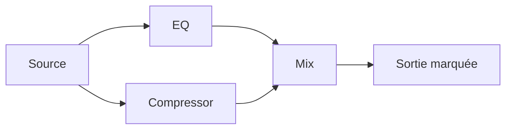
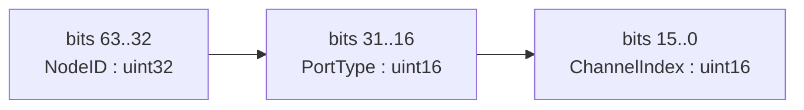
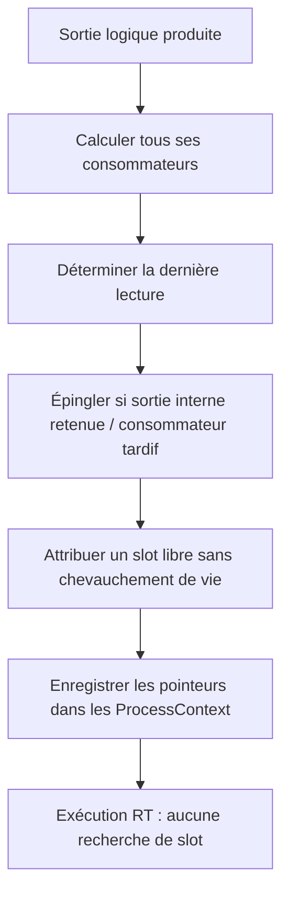
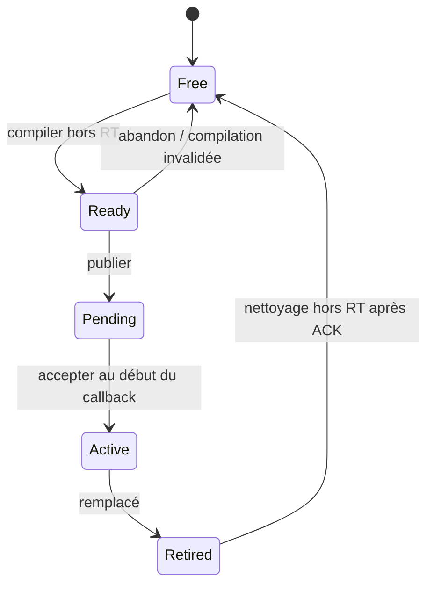
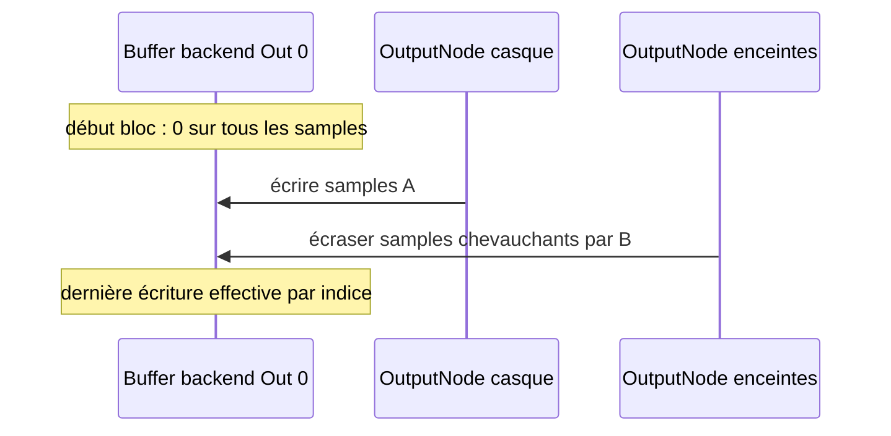
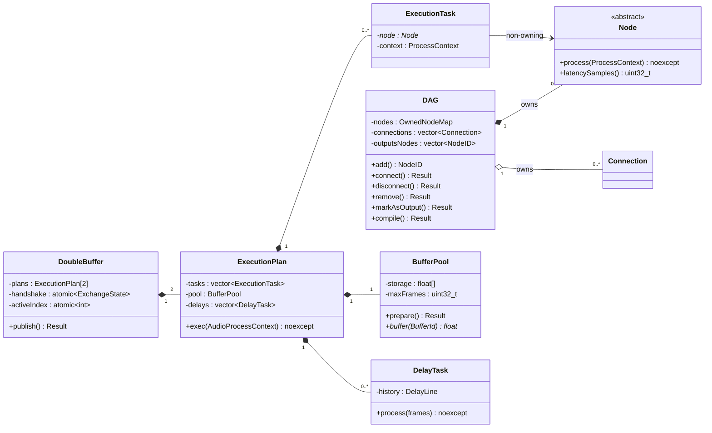
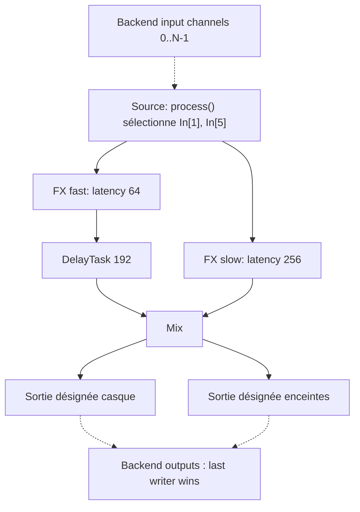

# Journal de décisions de recherche — MKA Audio DSP V1

**Période de conception restituée :** septembre–31 octobre 2026.  
**Statut de référence :** ce document distingue impérativement ce qui a été **validé**, **écarté**, **reporté** et **proposé pour clarification**.  
**Sources de travail :** discussions de conception, journal du 25/10, schémas Excalidraw joints. Des contradictions historiques sont conservées et datées comme « remplacées ». Voir [sources](../05-annexes/SOURCES_ET_CONCORDANCE.md).

## 0. Objectif du projet et méthode de lecture

Construire, en C++26, la couche de traitement audio de `mka::audio::dsp`, découplée des systèmes audio (ALSA/JACK/PipeWire, puis Windows/macOS), destinée à des applications temps réel, des plugins et un futur DAW. Une interface de graphe éditable coexiste avec un plan d'exécution déterministe adapté au callback. L'API publique ne lance pas d'exceptions dans son chemin normal ; la gestion d'erreur de configuration/compilation utilise `std::expected`. Le callback ne bloque pas, n'alloue pas et n'effectue pas de destruction complexe.

Une **décision** signifie ici un arbitrage d'architecture, non une preuve d'implémentation. Les diagrammes « classes » décrivent des rôles et des membres *suggestifs* lorsque la signature exacte n'avait pas été figée dans la discussion. Les diagrammes d'algorithme montrent le comportement retenu ; les détails restant à définir sont explicitement marqués.

## 1. Historique raisonné : fondations du DAG

### JD-001 — DAG de processeurs, non graphe à pointeurs exécuté directement — VALIDÉE

**Besoin :** enchaîner des traitements, représenter splits, mix, chemins parallèles, plugins. **Option A étudiée :** nœuds liés par pointeurs, chacun appelant directement ses successeurs. **Option B retenue :** `DAG` mutable sur thread de contrôle + `ExecutionPlan` compilé et autonome sur thread audio. **Raisons :** permet détection des cycles, ordre stable, réutilisation des buffers, publication atomique d'une nouvelle topologie, pas d'algorithme de graphe à exécuter dans le callback.



Chaque flèche est conceptuellement une ou plusieurs liaisons **par canal**. Le graphe présenté est logique : les canaux ne sont pas des buffers attribués à ce stade.

### JD-002 — Exécution séquentielle topologique V1 — VALIDÉE

**Piste :** un thread par nœud ou paralléliser les branches indépendantes par couches (`ExecutionLayer`, `WorkerPool`). **Écartée V1 :** crée des barrières, du partage de mémoire, une programmation parallèle temps réel difficile à borner, avec un gain non mesuré. **Retenu :** un seul thread audio exécute les `ExecutionTask` dans un ordre topologique stable. **Plus tard :** multicœur seulement si les mesures du chemin critique le justifient.

### JD-003 — `DAG::compile()` au lieu d'un `GraphCompiler` public — VALIDÉE

**Étudié :** une classe de compilateur séparée. **Retenu :** méthode publique de `DAG`, pouvant utiliser des fonctions/objets helpers privés. **Motif :** l'API reste petite ; l'implémentation conserve sa modularité en interne. La compilation est une opération **non RT**. Un échec ne change pas le plan en cours d'exécution.

### JD-004 — Trois ports `In`, `Out`, `Aux` — VALIDÉE

`PortType` est une `enum class`. Les entrées principales reçoivent l'audio ordinaire, `Aux` porte un signal auxiliaire/sidechain, `Out` produit un signal. Les catégories additionnelles (MIDI, événements, ports de contrôle spécifiques) ne sont pas ajoutées à la topologie audio V1. La signification des canaux auxiliaires est décidée par le processeur ; aucun downmix mono implicite n'est imposé.

### JD-005 — `ChannelID` compact encodé sur 64 bits — VALIDÉE

Construction : **32 bits `NodeID` + 16 bits `PortType` + 16 bits `channelIndex`**. Les évolutions historiques « 32+32 pour portID/channel » et « ID de port indépendant » ont été remplacées. `ChannelID` identifie un canal **logique**, et non une adresse mémoire. `NodeID` figure dans l'encodage sur 32 bits, même si certaines maquettes nommaient le champ `nodeID:u64`. Le plafond `maxNodeCount = 65 535` apparaît dans la maquette ; il ne découle pas mécaniquement des 32 bits et doit rester une limite de configuration/documentation tant qu'elle n'a pas été réaffirmée comme constante normative.



### JD-006 — Validation des connexions structurelle, indépendante des layouts — VALIDÉE (corrige l'ancienne maquette)

`connect(destination: In|Aux, source: Out)` accepte les canaux cohérents **même s'ils n'apparaissent pas dans `Config::layoutInput/layoutOutput`**. Le `Config` indique les canaux que `process()` traitera, non les seuls canaux structurellement connectables. **Ancienne option rejetée :** refuser une connexion dès que le canal n'est pas déclaré ; cette mention subsiste dans un schéma Excalidraw ancien et est **obsolète**. Conditions retenues : nœuds existants, port source `Out`, port destination `In`/`Aux`, absence de cycle, pas d'arête identique dupliquée, une seule source par canal destination. Une sortie peut alimenter plusieurs destinations distinctes ; sans duplication de ses samples. La création de sommation implicite lors d'un double branchement vers une même entrée est rejetée.

### JD-007 — Mix et Split explicites — VALIDÉE

`Mix` rassemble N entrées sur une sortie par sommation voulue par le développeur ; `Split` duplique une entrée vers N sorties logiques. Le DAG n'ajoute pas automatiquement des copies, conversions ou downmix invisibles. Une duplication par fan-out de pointeur n'est pas équivalente à un nœud Split : l'une partage une source existante, l'autre représente une transformation fonctionnelle explicite. **Politique de niveau :** pas de normalisation implicite dans le cœur.

### JD-008 — Stéréo pragmatique, canaux génériques numérotés — VALIDÉE

Historiquement explorés : layouts multicanaux nommés (mono, stéréo, 5.1, 7.1...), puis n-canaux général avec gestion des downmixs. **Direction retenue :** cœur basé sur des canaux identifiés et routages explicites, usage DAW stéréo prioritaire ; une source mono peut être dupliquée explicitement en stéréo selon les nœuds/règles applicatives. Pas de conversion silencieuse 5.1↔stéréo. Le backend peut néanmoins exposer de nombreux canaux indépendants.

## 2. Contexte audio et mémoire

### JD-009 — `Node::process(ProcessContext)` — VALIDÉE

Un `Node` est un processeur à identité stable dans le `DAG`. `process` est `noexcept`, appelé **uniquement sur thread audio** pour le plan actif, une fois par callback selon l'ordre compilé. Son `ProcessContext` contient `inputs`, `auxiliary`, `outputs`, `frames`. Chaque canal du contexte contient son identité et une **vue non propriétaire** vers des samples. **Contrat de lecture/écriture :** `inputs` et `auxiliary` en lecture seule ; `outputs` modifiables, sous réserve des règles des buffers backend. Le nœud n'alloue ni ne conserve les vues sur la mémoire du backend après le callback. Ses états algorithmiques internes (FFT, convolution, phase, etc.) peuvent survivre entre callbacks, sans être alloués dans `process`.

### JD-010 — Une frame count par callback, capacité `maxFrames` préparée — VALIDÉE

Le backend publie un seul `frames` pour toutes ses entrées/sorties lors du callback. Sa valeur peut varier entre callbacks. Toutes les tâches utilisent le nombre effectif, jamais une taille figée supposée. La compilation reçoit `maxFrames`, borne préparée. `frames <= maxFrames` s'exécute directement ; `frames > maxFrames` ne provoque aucun dépassement et produit du silence sûr, avec demande de reconfiguration non bloquante. **Écartés :** FIFO globale pour imposer une taille de bloc fixe, découpage automatique en sous-blocs, redimensionnement RT, taille de callback imposée pour toujours. Les plugins exigeant des blocs spéciaux s'adaptent en interne, sans affecter le graphe entier.

### JD-011 — Buffers mono `float32`, homogènes — VALIDÉE

Chaque slot physique contient `maxFrames` floats. Un chemin stéréo possède deux slots. Les buffers flottants sont l'interface interne normalisée ; le backend reste responsable de ses conversions depuis/vers les formats matériels int16/int24/int32/float32. La taille uniforme simplifie `BufferPool`, le recyclage et les preuves d'absence de dépassement. Les tailles variables par effet ont été explorées puis rejetées comme politique globale V1.

### JD-012 — `BufferPool` possédé par `ExecutionPlan` — VALIDÉE

Un plan est propriétaire de son pool, les contextes ne possèdent pas ses samples. Le pool peut fournir un slot réservé au silence, initialisé à zéro, jamais recyclé ni écrit par les processeurs. Le pool est préparé hors RT ; seules ses zones déjà préparées sont lues/écrites dans `exec`. Le schéma d'octobre propose `maxMemoryBytes=0,5 Go` et un buffer de silence `ID 0` ; **le chiffre est une proposition historique**, non une nécessité algorithmique ni une constante intrinsèque. Le plafond doit être configurable, mesuré et explicité. Le pool peut contenir une capacité supplémentaire (*headroom*) pour limiter les réallocations au fil des recompilations ; cette optimisation n'est pas indispensable au contrat logique.

### JD-013 — Recyclage par `lastUse` statique — VALIDÉE

`compile()` calcule l'ordre des tâches puis, pour chaque sortie effectivement matérialisée, la dernière tâche qui lira sa valeur. Quand ce dernier consommateur a terminé, le slot peut être affecté à une autre sortie **sur un traitement ultérieur**. Les sorties nécessaires après le bloc doivent rester accessibles jusqu'à leur consommation ; les sorties matérielles sont externes et n'appartiennent pas au pool. **Écarté :** un buffer exclusif permanent pour chaque sortie. Aucun `pool.acquire()`/`release()` dynamique en plein `exec()` : ces opérations sont des décisions de placement durant la compilation.



### JD-014 — In-place uniquement si prouvé sûr — VALIDÉE / détails À ARBITRER

Autoriser entrée/sortie sur le même slot **si** le processeur annonce la compatibilité, si aucun autre consommateur n'a encore besoin de l'ancienne valeur et si l'aliasing multicanal respecte un contrat précis. **Écarté :** copier systématiquement tous les inputs avant tout `process`. **Point à spécifier :** déclaration d'aliasing détaillée par nœud, au-delà d'un unique `supportsInPlace()` ; l'option conservatrice est de ne pas exploiter l'in-place tant que la preuve manque.

### JD-015 — Les historiques d'effets ne sont pas des slots de passage — VALIDÉE

FFT, delay, convolution, état d'oscillateur et PDC gardent leur mémoire persistante pendant la durée de vie de l'instance/du plan selon son propriétaire. Cette mémoire ne doit pas être libérée après chaque usage de bloc. Le pool des buffers temporaires ne se substitue pas aux états internes.

## 3. Publication, plans persistants et destruction

### JD-016 — Deux `ExecutionPlan` persistants A et B — VALIDÉE

Un `DoubleBuffer<ExecutionPlan>` possède exactement deux plans, destinés à alterner `front` (RT) et `back` (contrôle). **Écartés :** allocateurs de plans illimités, swap qui détruit un plan dans le callback, modification en place du plan actif. Un plan est compilé puis rendu `Ready`, ensuite publié `Pending`. Le RT l'adopte à une frontière de bloc, l'ancien devient `Retired`, puis le contrôle libère ce dernier après confirmation.



### JD-017 — Handshake atomique à trois états, pas de queue SPSC — VALIDÉE

`ExchangeState {Idle, Pending, Acknowledged}` est un `enum class` stocké dans un `std::atomic`. **Contrôle** écrit le plan arrière puis `store(Pending, release)`. **Audio** observe `Pending` avec `load(acquire)`, swappe sa sélection d'index, écrit `Acknowledged` en `release`, exécute le nouveau plan. **Contrôle** observe l'ACK `acquire`, nettoie l'ancien plan, écrit `Idle` en `release`. Un seul changement en vol. **Pistes abandonnées :** queue SPSC générale ou échange des pointeurs sans confirmation de retrait ; la confirmation est essentielle à la destruction.

```mermaid
sequenceDiagram
 participant CT as Contrôle
 participant DB as DoubleBuffer
 participant RT as Callback RT
 CT->>DB: compiler back B (Ready)
 CT->>DB: publish B; store Pending/release
 RT->>DB: load Pending/acquire
 RT->>DB: choisir B, A devient Retired
 RT->>DB: store Acknowledged/release
 RT->>RT: exec B
 CT->>DB: load ACK/acquire
 CT->>DB: détruire ressources Retired A
 CT->>DB: store Idle/release
```

**Précision d'implémentation indispensable :** `index` est atomique dans la maquette ; son protocole exact d'accès doit garantir qu'aucun thread n'accède au mauvais plan avant ou après l'acquittement. L'enum d'état est l'unique autorité de publication. Le RT n'attend jamais `Idle`, et le contrôle ne réutilise jamais une mémoire publiée avant la confirmation.

### JD-018 — Suppression physique des nœuds seulement hors des plans — VALIDÉE

L'utilisateur veut réellement détruire l'objet `Node`, pas simplement masquer ses connexions. Une suppression qui laisserait un `Node*` dans A ou B provoquerait une utilisation après libération. **Retenu :** la destruction n'est possible que lorsqu'aucun plan `Active`/`Pending`/`Ready`/`Retired` ne référence l'objet. Le plan `Ready` peut être invalidé, le plan `Retired` nettoyé après ACK ; si l'objet demeure dans un plan actif, renvoyer `NodeInUse` ou appliquer le workflow « retirer des connexions dans le graphe souhaité, compiler/publier une génération sans ce nœud, attendre ACK, détruire ». **Écarté :** détruire immédiatement lors d'un clic UI ; destruction RT.

### JD-019 — Graphe souhaité vs graphe actif — VALIDÉE

Le contrôle peut accumuler des modifications pendant que le plan A exécute une version antérieure. Le DAG représente l'état *souhaité*, le plan actif représente l'état *engagé* par RT. La compilation de B→C peut échouer (ressources insuffisantes, prepare() refusé) alors que le graphe souhaité est déjà valide structurellement. **Règle :** conserver A actif et reporter l'erreur ; ne pas prétendre que le souhait a été appliqué. Plusieurs éditions peuvent être fusionnées avant compilation/publication.

### JD-020 — Tails sans vidange audible V1 — REPORTÉE

`TailInfo` est retenu comme métadonnée de traitement ; faire continuer une queue d'effet supprimé peut nécessiter une ressource de sommation temporaire sur une destination réutilisée et une vérification des cycles. L'idée « vidanger sans concept nouveau » a été invalidée. **V1 :** ne pas garantir la continuité audible de la queue après suppression d'un effet.

## 4. Itérations de routage backend → DAG

### JD-021 — Pointeurs de backend non connus à la compilation — CONSTAT VALIDÉ

`AudioProcessContext` fournit des listes de pointeurs pour **le callback courant uniquement**. Le plan est compilé hors RT ; il ne peut pas enregistrer à ce moment une adresse matérielle définitive. Les entrées sont contractuellement `const float*`. Les sorties sont `float*`. Toute référence externe doit être remplacée au début de chaque callback et ne doit pas être conservée après.

### JD-022 — Copie directe aux frontières (`InputBinding`/`OutputBinding`) — ÉCARTÉE comme mécanisme général final

**Piste initiale :** `InputNode`/`OutputNode` dédiés, compilation de correspondances index backend → slot interne, copie au début et à la fin du bloc. **Avantages :** excellent confinement, pointeurs internes stables, faciles à tester. **Motif du rejet final :** ajout de structures spécifiques et de copies imposées alors que l'utilisateur veut choisir le routage dans `Node::process`. Conserver comme fallback possible pour une intégration qui exige une copie de sécurité, pas comme contrat de base.

### JD-023 — Patcher `InputNode.Out` seulement — ÉCARTÉE

Changer `Source.Out[0].buffer` ne change **pas** `EQ.In[0].buffer` si ce dernier en avait copié la valeur lors de la compilation. **Solution explorée :** enregistrer tous les `float**` consommateurs et les réécrire ; viable mais complexité de compilation et risque de pointeurs instables. Rejetée au profit de la modification de **l'entrée** du seul nœud source, en laissant les sorties internes intactes.

### JD-024 — Règles de mappings dans `layoutInput`, puis types spéciaux — ÉCARTÉES

**Essais :** ranger les indices physiques 2/6 dans `layoutInput` d'un `InputNode`, config spécialisée `backendChannels`, classe dérivée `InputNode`, puis `NodeID` hardware réservés et `Connection` ordinaires converties en opérations. Tous permettent le routage, mais ajoutent une distinction de nature matérielle ou changent le sens d'un layout. **Choix final :** les sources reçoivent toutes les entrées backend ; le développeur choisit les canaux dans `process`.

### JD-025 — Toute source topologique reçoit toutes les entrées — VALIDÉE, décision finale

Un **nœud source** = aucun prédécesseur connecté dans le DAG compilé. Avant son `process`, `ProcessContext::inputs` est remplacé par l'intégralité des canaux du callback backend (vues `const float*`, compteur exact). **L'absence de `layoutInput` ne bloque pas cet accès** ; pour un nœud source, la liste des entrées matérielles n'est pas filtrée par les layouts. Oscillateur/synthétiseur/générateur peuvent ignorer ces entrées et produire leurs propres samples. La présence de connexions entrantes dans une génération ultérieure supprime la classification source dans **cette** génération. Seuls les descripteurs d'entrée sont remplacés : ni les sorties des nœuds, ni les affectations `BufferPool` ne changent.

### JD-026 — Entrées backend en lecture seule — VALIDÉE

Le backend fournit des canaux non modifiables par le graphe. La représentation de référence est `const float*`; la propagation vers `ProcessContext.inputs` conserve cette propriété. Aucune écriture n'est permise, même sous prétexte d'in-place. L'accès hors callback est interdit.

## 5. Itérations de routage DAG → backend

### JD-027 — Plusieurs sorties désignées, sans classe matérielle obligatoire — VALIDÉE

`DAG::markAsOutput(NodeID)` ajoute un nœud dans `outputsNodes`. Tout nœud **désigné** reçoit l'accès à la totalité des canaux de sortie du backend dans `ProcessContext::outputs`, remplacés avant `process()`. Il décide librement quel canal physique reçoit quel signal, par exemple casque L/R et enceintes L/R. Ce routage ne relève plus du modèle `Connection`. **Le processeur traite les entrées ordinaires du DAG** et écrit directement dans les sorties externes. La durée de vie des pointeurs est limitée au callback.

### JD-028 — Pas de mixage implicite ; policy `last writer wins` — VALIDÉE

**Option examinée :** initialiser les sorties à zéro puis additionner toutes les contributions implicitement, sans réduction automatique ; permettrait plusieurs écrivains. **Écartée :** le moteur assumerait une responsabilité de mixage qui doit appartenir à un `Mix` explicite ; risque de niveaux > ±1 et d'effets non demandés. **Choix final :** tous les buffers matériels sont effacés avant le traitement, puis chaque nœud de sortie réalise des écritures de remplacement. Si plusieurs nœuds écrivent au même indice d'échantillon du même canal, le dernier exécuté gagne. Aucun verrouillage exclusif ni détection systématique des canaux déjà utilisés. La responsabilité du routage appartient au développeur/hôte.

**Important :** si deux nœuds ont des chemins indépendants, fixer un ordre topologique *déterministe* pour que LWW soit reproductible. Aucune écriture concurrente n'est autorisée ; en exécution multicœur cette règle demanderait une synchronisation ou une nouvelle politique.



### JD-029 — Alias de canaux par noms logiques — PISTE FACULTATIVE

Noms d'applications `HeadphonesLeft`, `HeadphonesRight`, `SpeakersLeft`, `SpeakersRight` peuvent être résolus en indices d'endpoint hors RT. Ils ne sont **pas** une garantie que des indices ou pointeurs suivent automatiquement un changement d'interface : un remappage est nécessaire lors d'un changement de configuration. Cette facilité applicative n'est pas requise dans le cœur V1 et ne doit pas entraîner des recherches de chaînes dans le callback.

### JD-030 — Vérification exclusive des sorties — ÉCARTÉE

**Piste :** imposer un seul nœud propriétaire par canal via `layoutOutput`, rejet de compilation en cas de double écriture. **Écartée par choix explicite :** trop de logique de routage dans le moteur, gêne la liberté d'implémentation. **Retenu :** LWW assumé, documenté, sans mixage ni vérification de collision.

## 6. Plugin Delay Compensation — dernière fonctionnalité V1

### JD-031 — PDC inscrit dans le périmètre V1 — VALIDÉE

La latence de traitement d'un plugin peut décaler son audio de `D` samples. Sans compensation, deux chemins convergents peuvent être désynchronisés. PDC insère un **retard additionnel** sur les branches les plus rapides, jamais une accélération du plugin le plus lent. Les retards sont des décalages **en samples**, non des temps CPU. Le moteur ne doit pas confondre `TailInfo`, PDC, fréquence d'échantillonnage et taille de bloc.

### JD-032 — Latence déclarée par `Node::latencySamples()` — VALIDÉE au niveau du contrat

Chaque processeur retourne sa latence algorithmique fixe en échantillons, `0` par défaut. Les adaptateurs VST3/AU/AAX convertissent le mécanisme du SDK en information interne. Il est impossible d'inférer fiablement la latence d'un algorithme arbitraire à partir de la durée de `process` ou de la taille de ses buffers. La déclaration est l'autorité pour le compilateur. **Proposition d'API :** `virtual std::uint32_t latencySamples() const noexcept`. Lecture sur thread de contrôle pendant la compilation ; valeur figée pour chaque plan. Changements ultérieurs nécessitent coordination hors RT et recompilation.

### JD-033 — Analyse topologique des chemins — VALIDÉE conceptuellement

Pour chaque nœud `v`, `P(v)` est sa latence. Le compilateur calcule `A(v) = max(L(u))` sur ses prédécesseurs `u`, puis `D(u,v)=A(v)-L(u)` sur chaque branche, enfin `L(v)=A(v)+P(v)`. Le calcul suit le tri topologique, complexité `O(V+E)` pour l'analyse, hors RT. Les entrées du nœud qui sont sémantiquement audio doivent être correctement groupées ; V1 retient une latence commune au nœud, pas une mesure indépendante par canal. L'algorithme de compensation globale entre plusieurs **sorties désignées** a été recommandé lors du brainstorming ; voir JD-037 pour sa limite lorsque les sorties écrivent elles-mêmes hors topologie.

### JD-034 — Retards comme opérations compilées — VALIDÉE conceptuellement / représentation PROPOSÉE

**Étudié :** placer de vrais nœuds `Delay` supplémentaires dans le DAG. **Écarté :** l'utilisateur n'a pas édité ces nœuds et la topologie souhaitée devrait rester stable. **Retenu :** matérialiser les corrections dans `ExecutionPlan`, sous forme de `DelayTask`/opération interne reliée à l'entrée d'un `ExecutionTask`. Les signatures exactes (`std::variant`, classe dérivée ou listes d'opérations avant tâche) restent à fixer, sans changer l'API publique du DAG. Un retard de 0 samples n'alloue pas d'historique.

### JD-035 — Ligne à retard circulaire persistante — VALIDÉE conceptuellement

`D` samples de retard représentent `y[n]=x[n-D]`. Un historique circulaire de longueur `D`, initialisé à zéro au **prepare** hors RT, conserve les samples entre callbacks. **Ce n'est pas** le double buffering des plans A/B. Exemple pour `D=3` et blocs de 4 : `in 1,2,3,4 → out 0,0,0,1`, puis `in 5,6,7,8 → out 2,3,4,5`. On ne remet pas le buffer de retard à zéro à chaque bloc. Une `DelayTask` ne réserve sa mémoire historique qu'à la préparation, jamais à l'exécution.

### JD-036 — Coexistence PDC + BufferPool — VALIDÉE conceptuellement

Les buffers intermédiaires avant/après compensation sont des slots mono temporaires soumis au `lastUse`. L'historique du retard reste propre à la `DelayTask` durant toute la vie du plan. Fan-out : chaque branche peut avoir son retard sans modifier la source partagée. Le calcul des durées de vie doit inclure les opérations PDC avant d'attribuer les slots : recycler à partir du DAG brut seulement serait incorrect.

### JD-037 — Compensation des sorties globales — RECOMMANDÉE, contrat exact À ARBITRER

L'analyse peut aligner la latence des chemins atteignant plusieurs nœuds terminaux. **Limite réelle :** ces nœuds écrivent librement sur les canaux matériels, éventuellement en les écrasant ; le compilateur ne sait pas quelles sorties effectives sont utilisées par leur `process()`. Il peut aligner des *chemins vers les nœuds déclarés terminaux*, mais **pas prouver** que toute écriture arbitraire dans les canaux matériels est alignée. Cette limite est une conséquence directe du contrat LWW et du routage interne choisi. V1 doit annoncer « compensation des entrées de chaque nœud et alignement des chemins vers terminaux connus » ; ne pas promettre une garantie globale par canal hardware tant que les écritures réelles ne sont pas déclarées.

### JD-038 — Changements dynamiques de latence — PARTIELLEMENT REPORTÉE

**Accepté :** nouvelle déclaration → recalcul hors RT → préparation d'un nouveau plan → handshake. **Non garanti V1 :** swap inaudible sans clic ou transfert immédiat d'état PDC entre plans. Les historiques de B sont au départ vides ; les recopier naïvement depuis un plan A encore actif provoquerait une data race. Les plugins dont la latence change doivent coordonner l'activation de leur configuration avec celle du plan, sans muter un objet partagé pendant `process`. **Reporté :** migration d'historiques à chaud, crossfade temps réel complet, événements/MIDI compensés.

### JD-039 — Limitations latence — PROPOSITION de gardes

Latences PDC exprimées en entier de samples et bornées par la mémoire disponible. Utiliser des calculs `uint64_t` vérifiés pour les sommes. `compile()` peut retourner `LatencyOverflow`, `CapacityExceeded` ou `PrepareFailed` plutôt que de produire un plan invalide. Latence de transport, entrées/sorties physiques, délai de périphérique et délai d'une autre horloge d'endpoint sont **hors** de l'analyse de latence algorithmique de la V1.

## 7. Chronologie globale des alternatives (récapitulatif)

| Itération | Alternative explorée | Statut final | Pourquoi |
|---|---|---|---|
| Représentation | Graphe de pointeurs avec appels récursifs | ÉCARTÉE | Pas d'ordonnancement/mémoire déterministes |
| Ordonnanceur | Un thread par nœud / couches parallèles | REPORTÉE | Coût et synchronisation RT |
| Compiler | `GraphCompiler` public séparé | ÉCARTÉE | API inutilement large |
| Ports | Mono/stéréo/multicanal imposés par formats | ÉCARTÉE pour cœur | Conversions implicites ambiguës |
| Ports | `In/Out/Aux` numérotés | VALIDÉE | Générique, simple |
| Validation | Refuser canal absent du layout | REMPLACÉE | Le layout décrit les canaux *traités* |
| Routing | Auto-mix vers même entrée | ÉCARTÉE | Contradit occupation 1:1 |
| Blocks | Constante `frames` globale, FIFO d'accumulation | ÉCARTÉE | Taille réelle du callback suffit |
| Buffers | Un buffer permanent par sortie | ÉCARTÉE | Consommation inutile |
| Buffers | Recyclage `lastUse` compilé | VALIDÉE | Borné et RT-safe |
| Buffers | Copies systématiques/in-place sans preuve | ÉCARTÉE | Surcoût / aliasing dangereux |
| Plans | Allocation-destruction pendant callback | ÉCARTÉE | Non RT |
| Plans | Deux plans + handshake atomique | VALIDÉE | Publication/retrait sûrs |
| Suppression | Effacer un Node alors que plan l'utilise | ÉCARTÉE | Dangling pointer |
| Entrées | Source dédiée + listes `InputBinding` + copies | REMPLACÉE | Routage libre dans `process` |
| Entrées | Réécrire sortie de Source et espérer propagation | ÉCARTÉE | Copie de pointeur ≠ alias de variable |
| Entrées | `NodeID` hardware réservés et arêtes spéciales | REMPLACÉE | Complexité de validation |
| Entrées | Tous les nœuds topologiques sources voient tout backend | VALIDÉE | Uniformité et choix du processeur |
| Sorties | Assigner des canaux exclusifs et vérifier collisions | ÉCARTÉE | Responsable du routing = app |
| Sorties | Mix automatique des écritures | ÉCARTÉE | Mix explicite voulu |
| Sorties | `last writer wins` séquentiel | VALIDÉE | Contrat simple et déterministe |
| PDC | Estimer latence par durée CPU / taille de buffer | ÉCARTÉE | Mesures non équivalentes |
| PDC | `Node::latencySamples` déclaré | VALIDÉE | Information algorithmique explicite |
| PDC | Insérer Delay dans le DAG utilisateur | ÉCARTÉE | Le plan peut ajouter l'opération |
| PDC | Historique circulaire en plan | VALIDÉE | Retard sample-précis entre blocs |
| PDC | Migration d'historique sans clic | REPORTÉE | États concurrents entre plans |

## 8. Schéma des responsabilités retenues



## 9. Cas concret complet : fan-out, sidechain, mix, sorties et PDC

Une même source lit les entrées backend `[1]` et `[5]` (prises physiques 2 et 6, indices C++ zéro-based). Son `process()` alimente deux sorties stéréo internes. Deux branches traversent des plugins avec latences 64 et 256 samples ; les signaux arrivent dans `Mix`. Le compilateur prépare un retard de 192 samples sur la branche la plus rapide. Le `Mix` alimente deux nœuds désignés comme sorties ; chacun copie vers les indices physiques choisis et peut être le dernier écrivain d'un canal selon l'ordre du plan.



**Schéma conceptuel seulement :** en stéréo, chaque arête audio représente normalement deux arêtes `ChannelID`, et la compensation correspond à un retard pour chaque canal synchronisé. L'alignement global casque/enceintes suppose que les chemins vers leurs nœuds sont connus et que leurs `process()` respectent les timings déclarés.

## 10. Critères de clôture de la recherche V1

Décisions fonctionnelles : DAG avec connexions par canal ; compilation hors RT ; tâches séquentielles ; pool mono `float32` préparé ; analyse du dernier usage ; in-place seulement si prouvé ; double plan + handshake ; destruction sans UAF ; sources accédant à tous les inputs backend en lecture seule ; sorties explicitement désignées écrivant à tous les outputs avec LWW ; PDC à latence déclarée, analyse topologique et retards circulaires persistants.

**Restent des questions d'API/implémentation à trancher avant de coder**, sans remettre en cause ces objectifs : sémantique terminale exacte de `markAsOutput` en cas de sortie connectée en aval ; coexistence d'un nœud source aussi marqué sortie ; aliasing du contexte et supports de `std::span` sans allocation ; stockage/activation du nouvel état d'un plugin dont la latence change ; garantie PDC entre les canaux hardware écrits arbitrairement ; configuration d'IO lorsque le nombre de canaux change ; politiques de transition à chaud. Elles figurent dans [QUESTIONS_OUVERTES](../05-annexes/QUESTIONS_OUVERTES.md).
