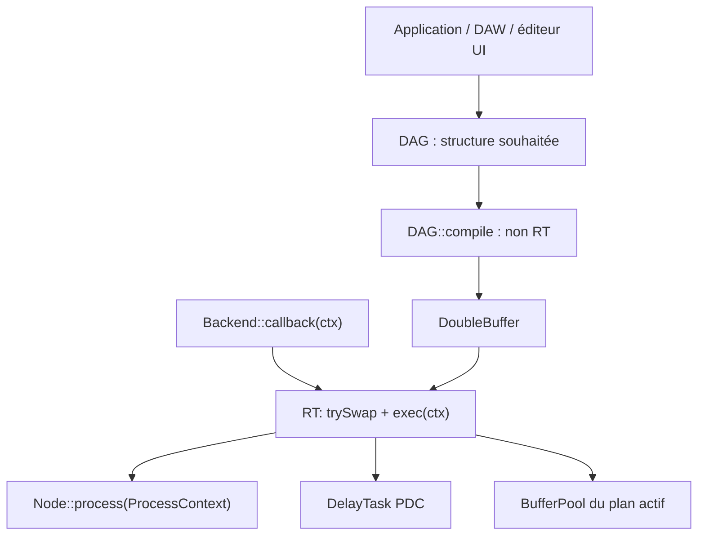
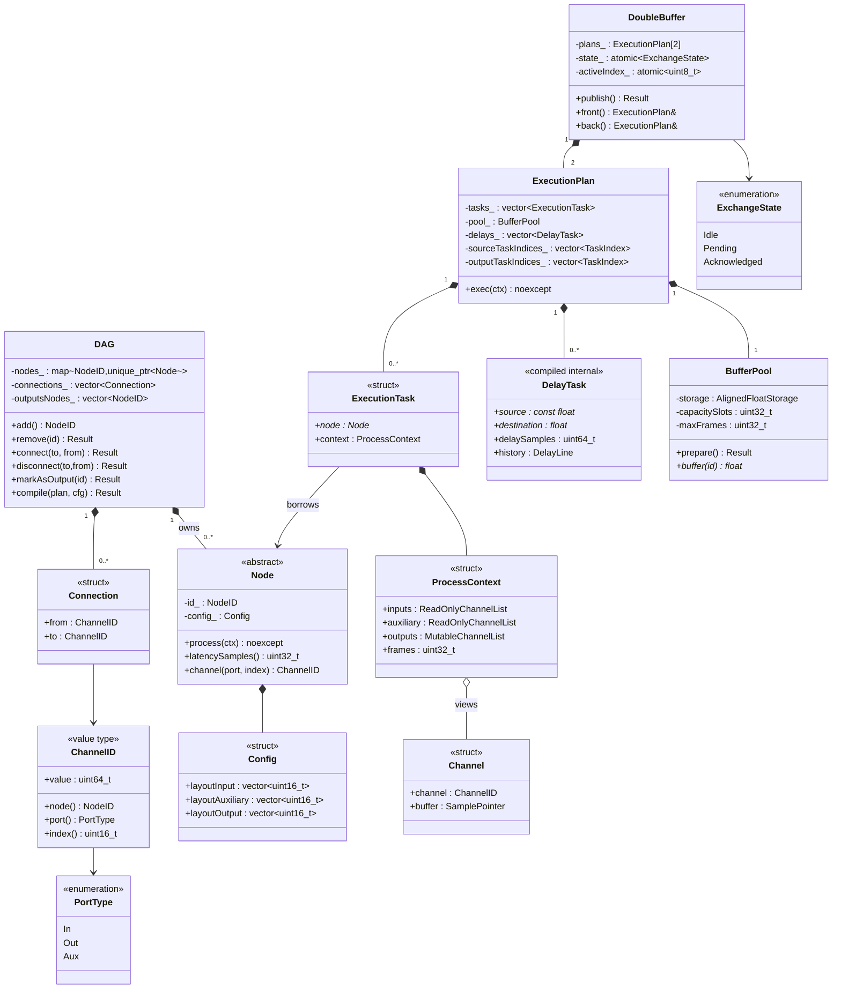
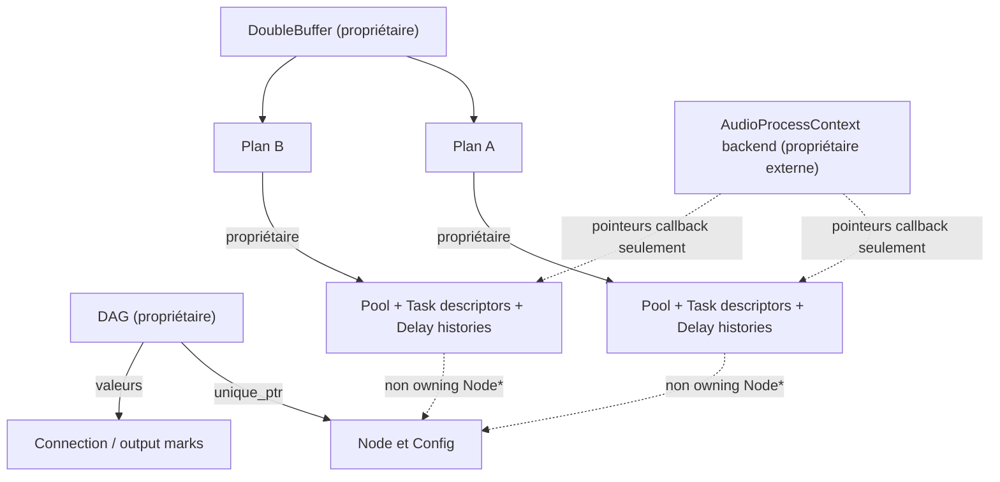
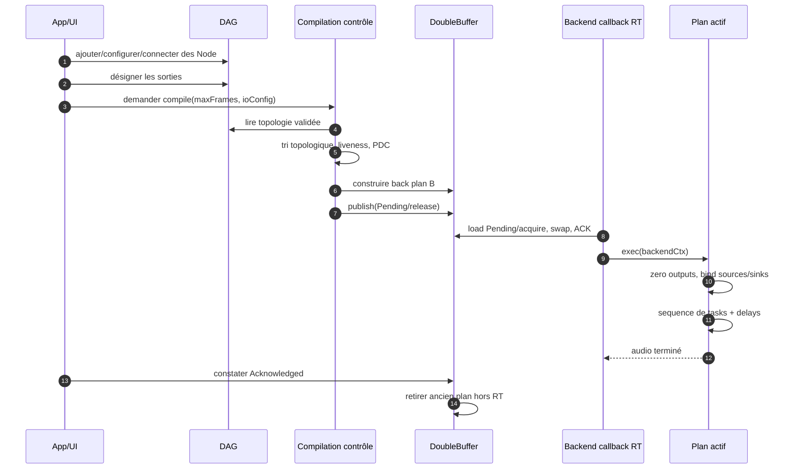

# Architecture générale du moteur DSP

## A. Vue d'ensemble des couches

Couche 0 (`mka::audio`) : backends ALSA/JACK/PipeWire, ultérieurement WASAPI/CoreAudio, choix d'endpoint, normalisation vers des buffers audio flottants par canal, callback `AudioProcessContext`. Couche 1 (`mka::audio::dsp`) : édition/validation du DAG, compilation, plans RT, mémoire et PDC. La couche 1 **ne dépend pas directement** des bibliothèques backend, uniquement de la forme normalisée du contexte audio. Le futur DAW pilote la couche DSP depuis le contrôle, sans appeler `process()` à la place du backend.

## B. Modèle de classes complet (proposition de structuration)

**Lecture des symboles UML :** `*--` composition (objet propriétaire), `o--` agrégation/vue dépendante, `-->` référence. `Node` est possédé par le DAG : le plan ne doit jamais le détruire. `ProcessContext` est la structure de descripteurs possédée par une tâche, mais ses pointeurs audio sont non propriétaires. `SamplePointer` est un raccourci UML pour `const float*` en entrée et `float*` en sortie, pas un type C++ unique validé.

## C. Classification des processus et accès

| Opération | Thread contrôle | Thread audio | Effets de bord / durée |
|---|---|---|---|
| `DAG::add/remove/connect/disconnect/markAsOutput` | Oui | Non | Modifie le graphe souhaité ; suppression physique soumise à l'absence de références dans tous les plans |
| `Node::channel` / validation IDs | Oui | Pas nécessaire | Pure construction logique ; pas d'accès aux samples |
| `Node::latencySamples` | Oui, à compilation | Non, dans la V1 | Propriété déclarative ; valeur figée dans le plan |
| `DAG::compile` | Oui | Non | Alloue, calcule topologie, PDC, pool, contextes ; peut échouer |
| `BufferPool::prepare` | Oui | Non | Alloue, initialise, peut échouer |
| `DoubleBuffer::publish` | Oui | Non | Publication atomique, pas de nettoyage du plan actif |
| `DoubleBuffer::trySwap` | Non | Oui, frontière de bloc | Lit état atomique, adopte plan prêt ; aucune attente |
| `ExecutionPlan::bindInputs/Outputs` | Non | Oui | Actualise seulement descripteurs préalloués vers buffers backend du callback |
| `ExecutionPlan::exec` | Non | Oui | Efface sorties matérielles, raccorde, exécute la séquence sans allocation |
| `Node::process` | Non | Oui | Lit entrées/aux, écrit sorties ; peut conserver son état algorithme |
| `DelayTask::process` | Non | Oui | Lit/écrit historique circulaire propre au plan |
| `DoubleBuffer::releaseRetired` | Oui | Non | Détruit ancien plan après ACK et libère ressources |

## D. Propriété des données (ownership)

**Règle fondamentale :** les pointeurs backend sont valides seulement pendant le callback ; les pointeurs vers le pool sont valides tant que le plan les possède et n'est pas réinitialisé ; les `Node*` restent valides tant qu'aucun plan ne les utilise. Les vues `std::span` vers des listes de descripteurs restent valides tant que ces listes ne sont pas redimensionnées/déplacées.

## E. Cycle de vie complet

## F. V1 vs extensions

**Dans V1 :** séquence de tâches mono-thread RT, sources avec toutes les entrées backend en `const`, sorties désignées avec toutes les sorties en `float*`, buffers internes mono float32, in-place conservateur, PDC sample-précis, recompilation/publish atomique. **Hors V1 :** parallélisme d'effets, compensation intégrée à MIDI/automation, transitoires strictement sans clic lors des swaps, drainage audible des tails, PDC entre interfaces physiques à horloges indépendantes, gestion arbitraire des layouts multicanaux standardisés.
