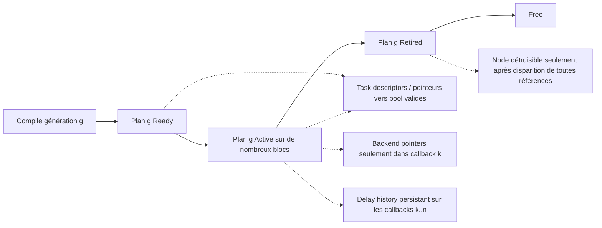

# Contrats transversaux : threads, mémoire, const, état

## 1. Modèle de concurrence

Deux participants : (1) **contrôle/compiler**, seul écrivain du graphe souhaité et du plan inactif ; (2) **audio RT**, seul utilisateur du plan actif. En V1, aucune tâche DSP ne s'exécute parallèlement à une autre au sein du même callback. Le backend appelle `exec` pour chaque bloc ; la compilation n'a pas le droit de modifier les objets audio référencés par un plan actif tant que celui-ci les utilise. Une modification de **configuration interne de `Node` partagé** peut elle-même créer une data race même si les `ExecutionPlan` sont séparés : les paramètres RT mutables exigent snapshot/atomics ou mécanisme de transfert explicite, hors de la simple garantie du double buffering.

**Interdits RT :** `new`, `delete`, `std::vector::resize` provoquant allocation, `std::mutex` bloquant, attente de futur, sleep, appels système bloquants, opérations de fichier, recompilation de graphe, destruction de `Node`, logging non borné. `std::atomic` est autorisé pour les indicateurs à faible coût ; la compatibilité lock-free de la plateforme doit être vérifiée. Aucune exception ne sort de `process` ou `exec`.

## 2. Carte des accès

| Objet/champ | Propriétaire | Contrôle | Audio RT | Modification après publication |
|---|---|---|---|---|
| `DAG::nodes`, `connections`, `outputsNodes` | DAG | Lecture/écriture | Aucune | Oui, graphe souhaité seulement |
| `Node::Config` préparée | Node/DAG | Lecture/édition coordonnée | Lecture si nécessaire | Pas de mutation non synchronisée sur Node partagé |
| `ExecutionPlan::tasks` / ordre | Plan | Écriture avant publication | Lecture | Non |
| `ExecutionTask::context.frames` | Plan | Initialisation | Écriture à chaque callback | Champ runtime explicitement mutable, accès RT exclusif |
| `context.inputs[].buffer` de source | Plan | Init descripteurs | Réaffectation à chaque callback (pointeur `const`) | Oui, seulement RT |
| `context.outputs[].buffer` de sortie désignée | Plan | Init descripteurs | Réaffectation à chaque callback (`float*`) | Oui, seulement RT |
| `context` des tâches internes | Plan | Prébinding | Lecture, hors frames | Ne pas re-router à chaud |
| `BufferPool::storage` | Plan | Allocation hors RT | Lecture/écriture samples autorisés | Taille/adresses fixes tant qu'actif |
| Slot silence | Plan | Init 0 | Lecture seulement | Jamais écrit/recyclé |
| `DelayLine::history` | Plan | Allocation et remise à zéro hors RT | Lecture/écriture échantillons | Oui, état exclusif RT |
| `Backend inputs` | Backend | Aucun accès du compilateur | Lecture seule, emprunt callback | Pointeurs remplacés prochain bloc |
| `Backend outputs` | Backend | Aucun accès du compilateur | Écriture séquentielle, LWW | Pointeurs remplacés prochain bloc |
| `ExchangeState` | DoubleBuffer | Store/load atomique | Store/load atomique | Oui, protocole strict |
| `Node*` dans les tâches | DAG possède Node | Référence non propriétaire | Appel de `process` | Node jamais détruit tant que référencé |

## 3. Durées de vie

Le plan d'un certain numéro de génération peut traiter une infinité de callbacks sans changement de capacité ni de layout. Les entrées matérielles ne peuvent pas être mémorisées de façon persistante dans un objet Node. Les historiques `DelayLine` sont **par plan** et ne doivent pas être confondus avec les buffers temporaires d'un callback.

## 4. Règles de validité `frames`

- Nominal : `0 < io.frames <= plan.maxFrames` et `io.input.count <= preparedInputCapacity`, `io.output.count <= preparedOutputCapacity` ; le RT écrit `ctx.frames=io.frames` dans toutes les tâches et opérations PDC.
- Dépassement : aucun déréférencement hors capacité ; initialiser autant de sorties externes que le callback autorise au silence et lever un indicateur RT-safe de besoin de reconfiguration. Ne pas exécuter le plan avec un contexte incomplet.
- Les canaux de silence dont le nœud attend la présence doivent contenir `frames` zéros ; la mémoire correspondante a au moins `maxFrames` éléments. Nul (`nullptr`) interdit dans une entrée qui sera déréférencée.
- Le nombre de canaux est validé **pour le callback réel** ; un backend peut se reconfigurer entre plans. Récompilation hors RT nécessaire pour augmenter la capacité des descripteurs.

## 5. Règles d'aliasing

Les sorties DSP peuvent être écrites ; les entrées DSP sont des vues en lecture seule. Le fait qu'une entrée soit `const float*` n'empêche pas physiquement qu'un autre pointeur mutable désigne la même zone. Cela doit donc être contrôlé par le plan : un producteur ne réécrit pas un slot partagé tant que tous les lecteurs de l'ancienne valeur n'ont pas terminé. In-place uniquement lorsqu'un processeur est documenté compatible ET qu'aucune autre consommation n'est encore en attente. Source externe backend : jamais d'in-place sur les samples du backend. Sortie externe backend : écrire seulement les indices réellement souhaités, ne pas présumer qu'un canal non écrit contient les données du callback précédent (les sorties sont effacées en début de bloc).

## 6. Publication, atomicité et ordre mémoire

`state_.store(Pending, std::memory_order_release)` par le contrôle, `state_.load(std::memory_order_acquire)` par RT, `store(Acknowledged, release)` par RT, `load(Acknowledged, acquire)` par contrôle. La modification de la sélection active doit suivre une convention fixe (échange d'indice par RT à la frontière du bloc ; lecture par contrôle uniquement lorsque l'état le permet) afin d'éviter une incohérence `index/state`. Un simple booléen « actif » ne suffit pas à déterminer quand détruire l'ancien plan. `Idle` n'autorise la préparation du back que lorsque le slot est effectivement `Free` et que le contrôle sait quel index est actif.

**Cas arrêt backend :** si aucun callback n'arrive pour accepter `Pending`, le contrôle ne doit pas attendre indéfiniment ; l'arrêt confirmé du backend peut servir de point de quiescence, avec transition explicite protégée par la garantie qu'aucun RT ne tourne. Cette procédure doit être définie dans l'intégration.

## 7. Gestion d'erreur

Les opérations contrôle renvoient `std::expected<... , ErrorType>`. Le plan actif reste valide après une compilation refusée. Le RT ne construit pas d'`std::string` et ne renvoie pas d'erreur allouant ; il peut poser un bit `std::atomic<uint32_t>` de diagnostic ou incrémenter un compteur lock-free. Les erreurs détaillées (ID incorrect, cycle, capacité, latence, slots manquants, NodeInUse) sont construites hors RT.

## 8. Contrats d'effets et PDC

La latence intrinsèque entière `latencySamples()` est cohérente avec le signal produit ; elle est lue hors RT. `TailInfo` indépendant, n'est pas une raison d'allouer un PDC. Pour les nœuds qui mélangent plusieurs entrées, l'alignement PDC précède leur `process`. Si l'algorithme impose des chemins internes d'entrée→sortie avec des retards différents, une unique valeur scalaire ne suffit pas à les décrire ; V1 ne garantit pas ces cas et exige un contrat plugin simplifié. Les historiques PDC démarrent à zéro après création du plan, une discontinuité peut survenir au swap.
