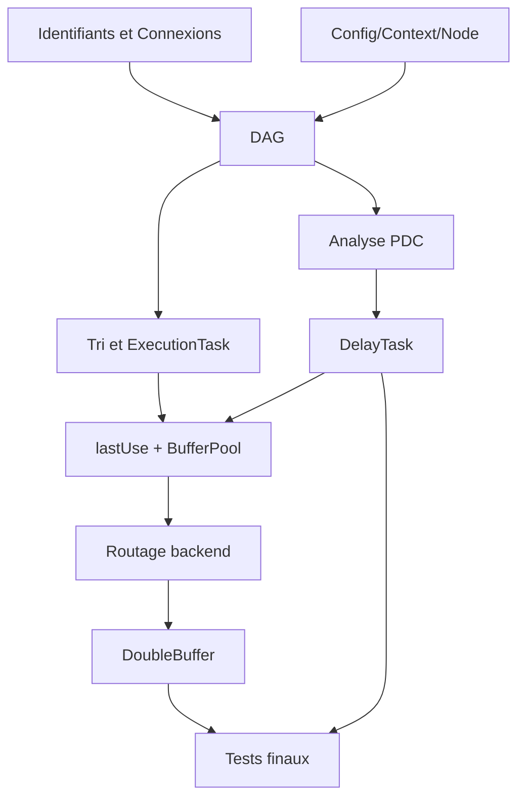

# Guide d'implémentation ordonné — du DAG au PDC

Ce guide décrit un **ordre de réalisation recommandé**, pas une promesse qu'une étape est déjà codée. Chaque étape est validée par ses tests avant de passer à la suivante. Conserver un plan actif stable et isoler le travail non RT du traitement audio dès le début.

## Étape 0 — Uniformiser les contrats et identifier les types

Figer `NodeID` (32 bits dans `ChannelID`), `ChannelID` (64 bits), `PortType` (In/Out/Aux), indices canaux sur 16 bits, compteur `frames` et capacité `maxFrames`. Fixer le type interne des `InputChannel` en lecture seule et des `OutputChannel` mutable. Supprimer toute hypothèse « un canal absent du layout ne peut pas être connecté ». Écrire tests encode/decode, sens, cycle, occupation.

## Étape 1 — DAG éditable

Implémenter stockage propriétaire stable de `Node`, collection d'arêtes, `outputsNodes`, `connect/disconnect/add/remove/markAsOutput`, tests exhaustifs 4 nœuds et vérification d'invariant. Interdire édition sur RT. Prévoir `NodeInUse` si Node déjà référencé.

## Étape 2 — Tri topologique et plan minimal

Construire `ExecutionPlan` immobile/stockage final, `ExecutionTask(Node*, ProcessContext)`. Préparer les listes de descripteurs une fois et résoudre les pointeurs *après* toute réallocation potentielle. Implémenter une `exec` séquentielle RT d'abord sans PDC, avec sorties initialisées au silence et `frames` variable. Tester source→gain→sortie.

## Étape 3 — Pool et liveness

Créer slots mono `float[maxFrames]`, slot silence en lecture seule ; analyse `lastUse` et `releaseAt`, vérification des budgets mémoire. Valider par oracle de simulations et instrumentation de `maxFrames`. N'introduire l'optimisation in-place qu'après l'analyse des aliasing.

## Étape 4 — Raccordement backend

À la compilation, lister tous les nœuds topologiques sources et tous les IDs de `outputsNodes`. Réserver la capacité de descripteurs d'après la configuration backend. Pendant chaque callback, remplacer les **pointeurs de contexte** des sources par la totalité des `io.inputs` en lecture seule, et ceux des sorties marquées par la totalité de `io.outputs` en écriture. Le `process` route lui-même par indices. Politique LWW séquentielle, sans détection des canaux déjà écrits. Tester changement d'adresse backend entre callbacks, absence de layoutInput source, nœud routeur 2→0 / 6→1, casque/enceintes.

## Étape 5 — Double buffering + handshake

Ajouter deux plans permanents, `Idle/Pending/Acknowledged`, publication release/acquire, swap seulement à frontière de bloc, retrait après ACK non RT. Tests de course et protocoles d'état. Tester la compilation B qui échoue sans perturber A. Bloquer destruction Node tant que référencé.

## Étape 6 — Contrat de latence

Ajouter `latencySamples()` (0 par défaut), séparé de `TailInfo`, sans appel depuis RT. Adaptateurs de plugin annoncent une valeur cohérente à la génération compilée. Tests de latence nulle, constante et signal d'actualisation hors RT.

## Étape 7 — Analyse PDC

Calculer `L(v)` sur tri topologique, `D(edge)` pour aligner les jonctions. Tester branches 64/256 et 192 de compensation, diamant, Aux, plusieurs sorties terminales. Vérifier arithmetic overflow. Définir un périmètre de garantie pour les nœuds sortants écrivant arbitrairement sur hardware.

## Étape 8 — DelayTask persistantes

Implémenter ligne circulaire par canal : exactement D samples d'historique, zéro-init hors RT, état continu entre blocs. Intégrer ses opérations au plan **avant** calcul du dernier usage, allouer les slots intermédiaires, relier le consommateur au slot compensé. Tester `D>frames`, callback variable et absence d'allocation.

## Étape 9 — PDC et publication

Nouvelle latence → recompilation du plan inactif, échec non destructif, publication au bloc suivant, historique B initialisé. Documenter absence de transition inaudible. Tester changement de latence et nœuds A/B partagés avec simulation de conflit de configuration.

## Étape 10 — Instrumentation et clôture V1

Revoir Doxygen sur API publique : ownership, accès const, thread, durée de vie, `noexcept` ; tests unitaires, integration backend, benchmarks temps de callback, consommation mémoire, sanitation. Mise en production seulement après examen des [points ouverts](../05-annexes/QUESTIONS_OUVERTES.md), car certains affectent directement la sécurité mémoire.

## Dépendances entre modules

## Définition de « V1 terminée »

La V1 est prête lorsque : un DAG valide peut être compilé en un plan préparé ; des callbacks à tailles variables sont traités sans allocation ni blocage ; les sources lisent tous les canaux backend sans écriture, et les outputs marqués écrivent leurs canaux en LWW ; les slots sont réutilisés uniquement après leur dernière lecture ; un changement de plan est publié sans destruction RT ; un Node encore référencé ne peut être détruit ; les latences déclarées se compensent sample-exactement dans les cas pris en charge, même sur plusieurs callbacks ; un échec garde l'ancien plan ; toutes les limites hors champ sont documentées.
