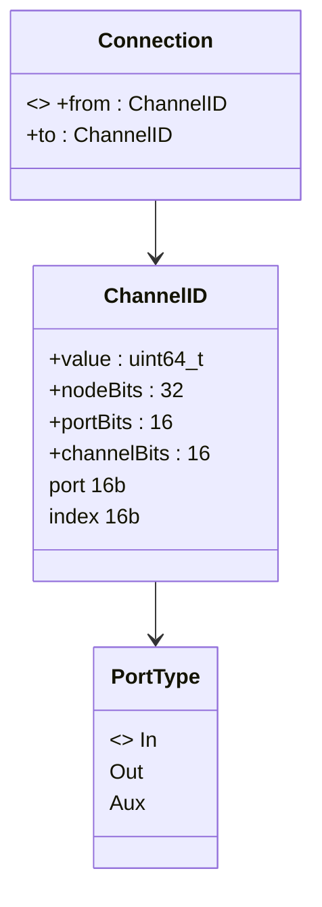

# Module 01 — Identifiants, ports et connexions

## Objectif

Identifier de manière stable les canaux logiques de chaque processeur et enregistrer les arêtes de la topologie indépendamment de la mémoire audio. Un `ChannelID` est une **valeur**, non un pointeur. Une `Connection` est une **structure** contenant un producteur et un consommateur. Ces types sont créés/modifiés sur le thread de contrôle, puis consultés pendant `compile()`, jamais utilisés pour retrouver des samples dans le callback.

## Types publics de référence

```cpp
namespace mka::audio::dsp {

using NodeID = std::uint32_t;
using ChannelIndex = std::uint16_t;
using ChannelID = std::uint64_t;

enum class PortType : std::uint16_t {
    In = 0,
    Out = 1,
    Aux = 2
};

struct Connection {
    ChannelID from; // Producer: Out
    ChannelID to;   // Consumer: In or Aux
};

constexpr ChannelID encode(
    NodeID node, PortType type, ChannelIndex index
) noexcept {
    return (std::uint64_t(node) << 32U)
        | (std::uint64_t(std::uint16_t(type)) << 16U)
        | std::uint64_t(index);
}

}
```

Les valeurs numériques de `PortType` sont un **choix de sérialisation proposé**, non un ordinal historique déjà figé. Le `ChannelID` de référence encode 32 bits de node, 16 bits de port, 16 bits de numéro ; les fonctions `decodeNode`, `decodePort`, `decodeChannel` doivent être pures et `constexpr`, tester/traiter tout port décodé hors enum. `NodeID` dans les maquettes a parfois été noté `u64` ; la largeur logique retenue de l'encodage est 32 bits.

## Contrat des connexions

- Le sens est `Out` source → `In` ou `Aux` destination. L'API historique `connect(input, output)` conserve éventuellement cet **ordre d'arguments** même si la structure stocke `from=output, to=input` ; documenter les noms `source` et `destination` pour éviter l'inversion.
- Refuser boucle, chemin qui créerait un cycle, nœud absent, destination déjà occupée, même arête enregistrée deux fois, direction impossible et indice hors champ encodable.
- Une sortie est réutilisable sur plusieurs arêtes ; une entrée individuelle ne reçoit qu'une seule sortie.
- **Ne pas rejeter une arête simplement parce que son indice est absent du `Config` du nœud**. La configuration déclare ce que `process` utilisera.
- Les arêtes concernent des canaux entre nœuds : pas de `NodeID` spécial hardware, ni de connexion backend dans cette V1.

## Exemple

```cpp
ChannelID eqInL = encode(eqId, PortType::In, 0);
ChannelID synthOutL = encode(synthId, PortType::Out, 0);
// graph.connect(eqInL, synthOutL) : valid if acyclic and input free.
```

## Visibilités / propriété / thread

`PortType` est public, trivially copyable ; `Connection` est public value-type stocké **par valeur** dans `DAG::connections_` privé. `encode` ne lit aucune mémoire partagée. `ChannelID` n'a aucune durée de vie de buffer attachée. `DAG` possède les arêtes. Les erreurs doivent être retournées hors RT, par exemple `InvalidDirection`, `CycleDetected`, `InputOccupied`, `NodeNotFound`, `ConnectionExists`. `Connection` n'est pas une liste de samples, ni un `Channel` du `ProcessContext`.

## Diagramme



## Tests

Encode/decode pour valeurs limites 0 et 65 535 ; rejeter port invalide ; tests de sens des arêtes ; double connexion ; auto-boucle ; cycle après chemin indirect ; fan-out autorisé ; occupation par canal `In` et `Aux` ; ports canaux non déclarés acceptés si structurellement valides ; suppression d'arête par identifiants exacts ; pas de dépassement d'encodage. Documenter les erreurs de contraintes structurelles avant les tests de ressources.
