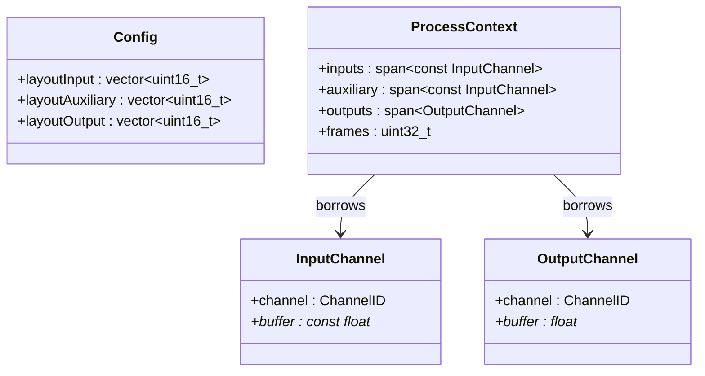

# Module 02 — `Config`, `Channel` et `ProcessContext`

## 1. `Config` : description fonctionnelle des canaux

```cpp
struct Config {
    std::vector<std::uint16_t> layoutInput;
    std::vector<std::uint16_t> layoutAuxiliary;
    std::vector<std::uint16_t> layoutOutput;
};
```

Les trois listes déclarent les numéros de canaux **effectivement traités** par le nœud : elles ne sont **pas** une liste d'autorisations structurales de `DAG::connect`. L'ordre de chaque liste détermine l'ordre exposé dans les tableaux du contexte ; les indices de layout sont des identifiants logiques, pas nécessairement `0..N-1`. Exemple `{2,6}` peut représenter deux identifiants logiques de canal ; ne pas confondre avec les prises physiques de backend dans un nœud ordinaire. Le développeur doit rechercher le champ `Channel::channel` ou utiliser une convention d'indexation documentée, sans supposer que `inputs[2]` signifie « canal logique 2 » si le layout n'en contient que deux.

Pour un **nœud source topologique**, le raccordement backend déroge volontairement à la sélection du layout : `ctx.inputs` expose **tous** les canaux physiques du callback, dans l'ordre backend. Pour un **nœud désigné sortie**, `ctx.outputs` expose **tous** les canaux matériels du callback, modifiables. Ces deux exceptions de contexte remplacent les hypothèses anciennes de « layout = mapping hardware ». `layoutAuxiliary` reste le layout des entrées auxiliaires internes, sauf cas à préciser si un nœud source avait des Aux non connectés (alors silence).

## 2. Descripteur de canal : ID + vue mémoire

L'ancienne maquette utilisait un seul type `Channel { channel:u64, buffer:f32 ptr }`. Pour appliquer l'exigence validée « entrées backend strictement en lecture seule », nous recommandons **deux variantes typées** de descripteur, sans ajouter de vue externe autonome :

```cpp
struct InputChannel {
    ChannelID channel{};
    const float* buffer = nullptr;
};
struct OutputChannel {
    ChannelID channel{};
    float* buffer = nullptr;
};

struct ProcessContext {
    std::span<const InputChannel> inputs;
    std::span<const InputChannel> auxiliary;
    std::span<OutputChannel> outputs;
    std::uint32_t frames = 0;
};
```

Cette séparation `InputChannel`/`OutputChannel` est une **proposition technique**, pas une modification déjà acceptée du nom `Channel`. L'objectif contractuel est non négociable : un `process` ne peut pas écrire à travers ses entrées. En C++, `std::span<const InputChannel>` empêche la réaffectation du descripteur par le nœud ; le RT peut cependant réaffecter les descripteurs stockés dans la tâche avant de construire/mettre à jour le `span` remis à `process`. `std::span<OutputChannel>` est une vue de descripteurs ; le moteur doit empêcher toute modification non prévue des pointeurs eux-mêmes pendant `process` si nécessaire en exposant une façade appropriée.

Un `ChannelID` dans un `InputChannel` source peut être une identité synthétique de position physique dans le contexte ou une valeur documentée ; **le développeur a validé l'accès par indice positionnel à l'intégralité du backend**, pas une réutilisation de l'encodage logique pour les canaux physiques. Il faut donc définir l'identité de contexte si l'API impose un `ChannelID` même aux canaux externes. Voir [questions ouvertes](../05-annexes/QUESTIONS_OUVERTES.md).

## 3. Contrat de `frames`

`frames` = nombre réel de frames du callback, commun aux canaux. `maxFrames` n'appartient pas au contexte de traitement mais à la préparation du plan. Les processeurs accèdent aux indices `0..frames-1` ; ils ne lisent jamais jusqu'à `maxFrames` par défaut. Les buffers d'entrée non connectés qui existent dans un contexte interne pointent vers un buffer de silence contenant au moins `maxFrames` zéros. Les canaux hors nombre d'entrée externe nécessitent validation/fallback définis par le nœud ou l'hôte.

## 4. Propriété et durée de vie

- `Config` : propriété du `Node`, construite/éditée hors RT selon le cycle de vie ; une mutation concurrente de config sur Node actif est interdite.
- Tableaux des `InputChannel`/`OutputChannel` : propriété de `ExecutionTask`, stabilisés avant publication ; *vues* dans `ProcessContext`.
- `InputChannel::buffer` interne : non propriétaire, vers un slot de plan/silence, jusqu'à la destruction/recompilation du plan.
- `InputChannel::buffer` externe d'une source : non propriétaire, vers le backend, **seulement le callback courant**.
- `OutputChannel::buffer` interne : non propriétaire, vers le pool ; écriture dans `process`.
- `OutputChannel::buffer` d'une sortie marquée : non propriétaire, vers le backend, **seulement le callback courant**.
- `frames` : écriture uniquement RT entre callbacks ; lecture pendant chaque `process`.

## 5. Exemple stéréo du canal physique 2 et 6

Les canaux backend sont indexés à zéro : 2e prise = `ctx.inputs[1]`, 6e prise = `ctx.inputs[5]`. Le source node peut utiliser `std::copy_n(ctx.inputs[1].buffer, ctx.frames, ctx.outputs[0].buffer)`. Vérifier `inputs.size() >= 6` et `outputs.size() >= 2` avant lecture ; si une entrée manque, écrire du silence dans le canal produit. Aucun objet `InputBinding` ni nœud hardware n'est requis.

## 6. UML


