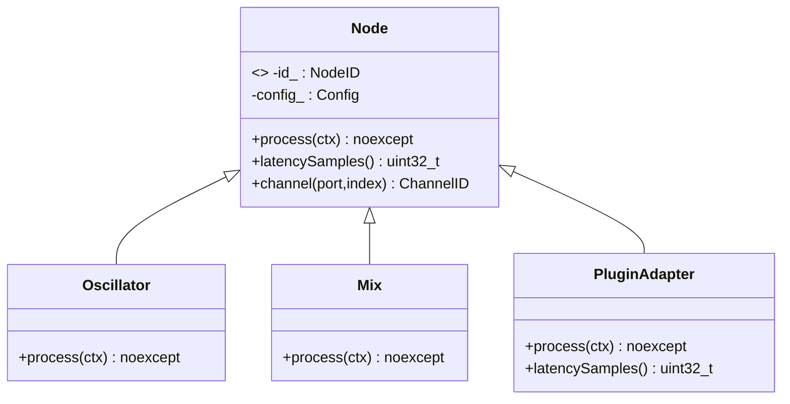

# Module 03 — `Node`, plugins, latence et `TailInfo`

## Objectif

Interface polymorphe des traitements audio. Le moteur connaît seulement sa configuration logique, sa latence déclarée et la fonction de traitement. Le code du nœud choisit l'algorithme : gain, oscillateur, mix, split, routeur hardware, EQ, compresseur, wrappers VST3/AU/AAX. Ne pas associer automatiquement un thread à un nœud.

## Interface de référence

```cpp
class Node {
public:
    virtual ~Node() = default;

    virtual void process(const ProcessContext& ctx) noexcept = 0;

    [[nodiscard]]
    virtual std::uint32_t latencySamples() const noexcept {
        return 0;
    }

    [[nodiscard]]
    ChannelID channel(PortType type, ChannelIndex index) const noexcept;

    [[nodiscard]]
    NodeID id() const noexcept;

    [[nodiscard]]
    const Config& config() const noexcept;

private:
    NodeID id_{};
    Config config_{};
};
```

`Node` est une **classe abstraite**, `Config` et identifiant lui appartiennent (l'injection ID/config pourrait être assurée par `DAG`). `process` est **public virtuel noexcept** ; il ne doit ni allouer, ni prendre un verrou, ni appeler le backend, ni conserver les pointeurs externes. `channel` est une méthode pure de création d'identité ; `latencySamples` est appelée par le compilateur sur contrôle, pas par `exec`.

Le modèle exact de configuration, la présence de `prepare()` dans la base `Node`, le mécanisme de paramètres et de réinitialisation sont **à préciser**. Les méthodes de préparation des effets peuvent échouer hors RT : le journal antérieur évoque `prepare()` refusé, sans signature publique définitivement validée. Ne pas imposer un nouveau `prepare` universel dans le contrat juste parce qu'il serait commode.

## Classes de nœuds au regard du graphe

Le terme **source** n'est pas une classe dérivée : c'est un nœud ne possédant **aucune arête entrante** dans le graphe compilé. Il reçoit toutes les entrées backend en lecture seule ; il peut ignorer les canaux (`Oscillator`). Le terme **sortie désignée** n'est pas non plus une classe imposée : `DAG::markAsOutput(id)` lui donne accès en écriture à tous les buffers sortants backend. Un nœud ordinaire possède uniquement des buffers internes selon ses layouts et connexions.

Un même objet `Node` peut potentiellement être classé source dans une génération puis intermédiaire dans la suivante : ses entrées ne représentent plus la même provenance. L'application doit comprendre cette conséquence. Cas d'un nœud à la fois source et sortie : ambigu en cas de contexte « tous les inputs externes » et « tous les outputs externes », à arbitrer expressément, non interdit par le concept en soi.

## Latence, état et Tail

`latencySamples()` = échantillons de décalage algorithmique du signal déclaré (0 par défaut). Valeur utilisée dans le calcul topologique PDC lors de la compilation. Ce n'est pas le coût CPU de `process()`. Une valeur erronée produit une mauvaise compensation, même si l'algorithme est correct. Les wrappers de plugins interrogent leur SDK (par exemple `getLatencySamples()` côté VST3) sur thread approprié et publient la valeur au compilateur. Un changement de latence implique une mise à jour coordonnée, pas une mutation libre du même `Node` actif.

`TailInfo` = information sur le signal persistant après disparition de l'entrée (ex. réverbération). **Conserver le concept/métadonnée V1**, mais ne pas garantir le drainage audible d'un effet retiré. Les deux propriétés sont orthogonales : un effet peut avoir une queue longue avec latence nulle.

## Ownership et synchronisation

`DAG` possède le Node ; `ExecutionTask` stocke un `Node*` non propriétaire. Durée de vie du Node : jusqu'à destruction contrôlée après retrait de **tous** les plans référents. L'état DSP interne de Node peut changer par `process()` sur RT. Le contrôle ne peut simultanément changer un état non atomique partagé pendant `process()`. Le double-buffer de **plans** ne double pas automatiquement les instances de **Node** : une stratégie de préparation distincte est nécessaire si un plugin doit changer sa propre configuration.

## Diagramme



## Tests

Gain sans latence, oscillateur source ignorant les entrées backend, source routant l'entrée physique 2/6 vers sorties logiques L/R, mix et split, changement de classification après ajout/retrait de connexion, latence déclarée non nulle, distinction tail/latence, destruction empêchée tant que référencé, absence de mutation de config concurrente.
