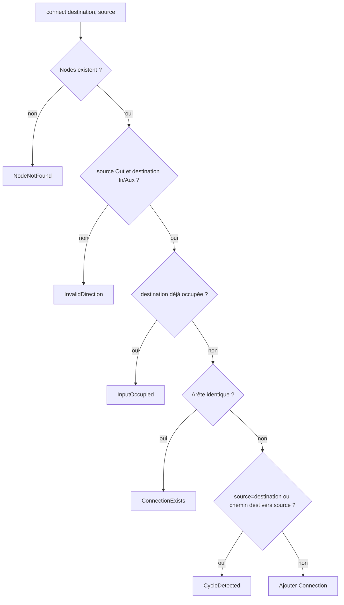

# Module 04 — `DAG` : propriété, édition, validation, compilation

## Responsabilité

Le `DAG` est la **description souhaitée** de la topologie. Il possède les instances `Node`, un conteneur de `Connection`, et des identifiants `outputsNodes`. Il ne possède pas les buffers matériels du backend ni n'exécute directement les nœuds depuis la UI. `DAG::compile` produit/prépare un plan inactif ; la publication appartient à `DoubleBuffer`.

## Signatures de référence

```cpp
class DAG {
public:
    template<class T, class... Args>
    std::expected<NodeID, Error> add(Args&&... args);

    Result remove(NodeID id); // Peut retourner NodeInUse.
    Result connect(ChannelID destination, ChannelID source);
    Result disconnect(ChannelID destination, ChannelID source);
    Node* node(NodeID id) noexcept;
    Result markAsOutput(NodeID id);
    Result unmarkAsOutput(NodeID id); // PROPOSITION de symétrie API.

    Result compile(ExecutionPlan& target, const CompileConfig& config);

private:
    std::unordered_map<NodeID, std::unique_ptr<Node>> nodes_;
    std::vector<Connection> connections_;
    std::vector<NodeID> outputsNodes_;
};
```

Les retours `std::expected` et le type `CompileConfig` sont une **proposition d'interface typée**. Les anciennes maquettes utilisent `add<T>() -> u64`, `remove(nodeID : u64)` et `compile() -> ExecutionPlan`. Le contrat obligatoire est erreur explicite hors RT, pas une signature exacte imposée. La structure `unordered_map` n'est pas un choix validé : conteneur propriétaire garantissant stabilité des adresses et identité suffit.

## Validation de `connect`



Les validations de canaux « déclarés par `Config` » ont été **supprimées**. Un canal non traité par le nœud peut être connecté, tant que l'identité et la structure sont valides. La connexion inverse sémantique (source/destination) est une erreur fréquente à couvrir par des tests.

## Suppression et références

`remove(id)` élimine les arêtes incidentes et retire le marquage de sortie dans l'état souhaité **seulement si** la destruction du Node est sûre ; sinon `NodeInUse` ou flux de retrait différé. Ne jamais supprimer physiquement un `Node` tant qu'un des deux plans, même `Ready` ou `Retired` non nettoyé, contient son pointeur. Pour retirer un nœud actif : créer un graphe souhaité sans lui, compiler une nouvelle génération sans référence, publier, attendre ACK, nettoyer A, enfin détruire l'objet. **PROPOSITION** : séparer `requestRemoval()` (édition souhaitée) et `collectRemovableNodes()` (destruction), car `remove` immédiat seul rend l'édition difficile ; les noms d'API restent à figer.

## Marquage des sorties

`markAsOutput(id)` expose au contexte de ce Node les `io.outputs` backend. Plusieurs IDs peuvent être marqués. Aucune politique d'unicité de canaux hardware : écriture directe séquentielle et **last writer wins**. Les sorties matérielles sont effacées au début du callback, et le routage est effectué par `Node::process`. **À ARBITRER :** si une sortie marquée possède elle-même des arêtes sortantes, ses `ctx.outputs` ne peuvent simultanément pointer vers des buffers internes et la totalité du backend sans une politique distincte. Pour garantir la V1 la plus simple, proposer de limiter `markAsOutput` aux nœuds terminaux (aucune sortie interne consommée), mais **cette limitation n'a pas été explicitement approuvée**.

## Compilation et garde transactionnelle

La compilation commence par un snapshot/lecture cohérente de l'état souhaité (un seul thread de contrôle). Elle valide la topologie, produit l'ordre des tâches, analyse les dépendances, PDC, liveness, dimensionne pool et delay lines, prépare les contexts, vérifie capacité et publie un résultat `Ready` non actif. Un échec de `prepare`, de mémoire, de latence ou de cohérence ne remplace **jamais** le plan actif. Ne pas construire un demi-plan puis publier ses pointeurs. Les détails sont dans [COMPILATION](../03-algorithmes/COMPILATION.md).

## Tests

Tous DAG de 4 nœuds et arêtes candidates, oracle de mutations, cycles, occupation, layouts non limitatifs, sortie marquée plusieurs fois, suppression et arêtes incidentes, plan compilé non affecté par une édition souhaitée, panne `prepare` sans destruction du plan A, délai de destruction après ACK. L'invariant de stabilisation de `Node*` est central.
