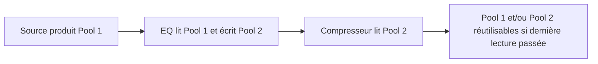
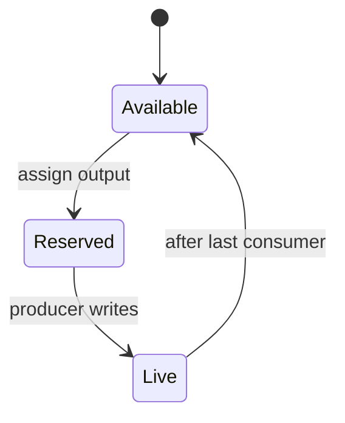

# Module 05 — `BufferPool` : allocation, silence et réutilisation

## Responsabilité et unité de stockage

Le pool appartient exclusivement à un `ExecutionPlan`. Un **slot** correspond à un canal mono de `maxFrames` `float` (4 octets chacun). Stéréo = 2 slots ; la mémoire audio interne est organisée par canal. La capacité doit être préparée **hors RT** et ne change jamais pendant l'exécution du plan. Le pool ne possède **aucun pointeur backend**.

## Interface indicative

```cpp
using BufferId = std::uint32_t;

class BufferPool {
public:
    Result prepare(std::uint32_t slotCapacity,
                   std::uint32_t maxFrames);
    [[nodiscard]] float* buffer(BufferId id) noexcept;
    [[nodiscard]] const float* silence() const noexcept;
    [[nodiscard]] std::uint32_t maxFrames() const noexcept;
    [[nodiscard]] std::uint32_t slotCapacity() const noexcept;

private:
    std::vector<float> storage_;     // PROPOSITION d'implémentation contiguë
    std::uint32_t maxFrames_ = 0;
    std::uint32_t slotCapacity_ = 0;
    std::uint64_t maxMemoryBytes_ = 0; // Configurable, PROPOSITION
};
```

La maquette historique contient aussi `acquire()`, `release()`, `silence()->BufferID`, et un emplacement de silence `0` non recyclable. Dans la V1 compilée, `acquire/release` sont **des opérations de l'allocateur du compilateur**, pas des appels RT. Exposer publiquement ces noms est facultatif ; l'absence de mémoire allouée par le RT est impérative.

## Règles d'ownership

`storage_` est possédée par le plan, détruite sur contrôle après retrait sûr. `ProcessContext.inputs/outputs` ne reçoivent que des vues vers des slots ; l'allocation peut déplacer `storage_` pendant la préparation, donc **résoudre les pointeurs seulement après la dernière opération pouvant réallouer**. Après publication, interdire `resize`, `reserve`, move des plans ou autre opération susceptible de déplacer les adresses. Alternative : slots individuellement alloués avec adresses stables, également hors RT ; la structure interne exacte du pool n'est pas imposée.

## Silence

Une zone contenant `maxFrames` zéros, distincte ou réservée dans le pool, sert aux entrées internes non connectées. L'ancienne maquette réserve le slot ID 0 ; retenu comme *modèle*, sous réserve des coûts. **Invariants** : silence jamais écrit, jamais donné comme sortie mutable, jamais rendu à la freelist. Pour les nœuds sources, `ctx.inputs` est remplacé par les entrées backend : il n'y a pas à allouer un silence par canal externe. En absence de canal backend, un fallback vers silence doit respecter la capacité et le nombre déclaré du contexte.

## Liveness : la raison du recyclage



Le compilateur parcourt les connexions et les tâches dans l'ordre topologique. Pour chaque sortie, `lastUse` est le dernier index de tâche qui exige encore sa valeur. Un slot peut être repris après cette tâche (ou au même index uniquement si l'ordre des opérations internes rend l'aliasing sûr et le nœud accepte in-place). Le calcul doit inclure les `DelayTask` PDC, et tenir compte des outputs encore requis par des consommateurs tardifs et éventuelles sorties du plan.

## Dimensionnement

Formule de base (hors alignement et historique PDC) :

`requiredBytes = slotCount * maxFrames * sizeof(float)`.

Avec `slotCount = peakLiveSlots + reservedSlots`, `peakLiveSlots` est déterminé par simulation hors RT des intervalles de vie. Un plafond `maxMemoryBytes` vérifie le produit avec multiplications contrôlées avant allocation. Le schéma d'octobre propose un plafond de 0,5 Go et une réserve de headroom environ 30 % + minimum 4 slots ; **ces valeurs sont des heuristiques de la maquette**, pas une limite obligatoire du moteur. Un test doit vérifier que le plan fonctionne avec la capacité minimale prouvée.

**Budget PDC séparé :** `sum(delaySamples * numberOfChannels * 4)` pour les historiques, plus les slots temporaires supplémentaires. Si tu fixes un budget de mémoire globale, ajouter les deux budgets dans le contrôle de capacité.

## In-place

Écraser l'entrée dans la sortie n'est correct que si le producteur n'a plus d'autre lecteur, si le nœud supporte l'aliasing et si le motif mono/stéréo reste sûr. Une entrée backend est toujours externe et `const` : jamais réutilisable comme sortie du pool. Si la preuve d'in-place manque, un slot distinct évite le risque. **Proposition pratique V1 :** désactiver d'abord l'optimisation, puis l'activer après tests spécifiques et instrumentation de `lastUse`.

## Diagramme d'état conceptuel d'un slot pendant la compilation



Ce diagramme décrit les **états simulés en compilation** ; les slots ne changent pas d'état d'allocation par callback. Les samples qu'ils contiennent, eux, changent en RT.

## Tests indispensables

Calcul exact `peakLive` chaînes, diamant, fan-out, nœuds indépendants ; slot 0 silence jamais écrasé ; `frames=maxFrames`, `frames=1`, capacité insuffisante, produit `uint64` overflow, alignement éventuel, stabilité des adresses après publication, disjonction d'intervalles, aliasing permis/refusé, PDC ajoutant consommation, pool B ne modifiant pas pool A.
