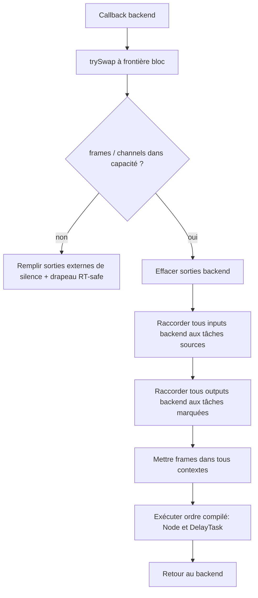

# Module 06 — `ExecutionTask` et `ExecutionPlan`

## Objectif

Transformer une topologie coûteuse à interpréter en séquence directe d'opérations RT. Le plan connaît l'ordre topologique, les contextes déjà reliés aux buffers internes, les nœuds sources, les nœuds sorties, les opérations PDC et les buffers préalloués. Il **ne fait aucune recherche de connexion dans `exec()`**.

## Structures de référence

```cpp
struct ExecutionTask {
    Node* node = nullptr; // emprunt au DAG, jamais propriétaire
    ProcessContext context{};
    // stockage de descripteurs à adresse stable : interne, non illustré
};

class ExecutionPlan {
public:
    void exec(const mka::audio::AudioProcessContext& io) noexcept;
    [[nodiscard]] bool references(NodeID id) const noexcept;

private:
    std::vector<ExecutionTask> tasks_;
    BufferPool pool_;
    std::vector<DelayTask> delays_;
    std::vector<TaskIndex> sourceTasks_;
    std::vector<TaskIndex> outputTasks_;
    std::uint32_t maxFrames_ = 0;
};
```

Les champs sont des **propositions de support**. L'ancienne maquette n'avait que `tasks` et `pool`; les listes de tâches sources/sorties et delays matérialisent les nouvelles décisions sans nécessiter de modifications de `Node::process`. Les pointeurs des tableaux de contexte doivent rester stables après construction. Si les vecteurs de tâches sont réalloués/déplacés après compilation des vues, ils peuvent invalider ces vues : réserver d'avance ou utiliser un stockage stable et ne publier qu'une fois totalement terminé.

## Séquence RT



Les sorties externes sont mises à zéro avant l'exécution. En cas de plusieurs écritures sur le même sample/canal, la dernière dans l'ordre séquentiel gagne. **Pas** de mixage automatique. Pour un nœud source : ses `ctx.inputs` pointent vers **tous** les canaux d'entrée backend en `const`; ses `ctx.outputs` restent les buffers internes attribués. Pour un nœud marqué sortie : ses `ctx.outputs` pointent vers **tous** les canaux de sortie backend ; ses `ctx.inputs` restent reliés aux prédécesseurs. Le routage du canal utilisé appartient au nœud.

## Pseudocode détaillé

```cpp
void ExecutionPlan::exec(const AudioProcessContext& io) noexcept {
    if (!capacityMatches(io)) {
        clearAllHardwareOutputs(io);
        reconfigureRequested_.store(true, std::memory_order_relaxed);
        return;
    }

    clearAllHardwareOutputs(io);
    bindSourceInputDescriptors(io);  // No allocations, no copies of samples.
    bindOutputDescriptors(io);       // No allocations, no copies of samples.

    for (auto& operation : compiledOperations_) {
        // Could be ProcessNode or Delay; exact representation is open.
        operation.execute(io.frames);
    }
}
```

Ce code est volontairement **pseudocode** : `compiledOperations_` et `reconfigureRequested_` représentent des éléments à définir, et ne doivent pas être copiés tels quels sans leur déclaration. Le contrat essentiel est qu'un ordre de tâches précompilé incorpore les `DelayTask` juste avant les consommateurs et prépare les contextes des processeurs.

## Vie du plan

- **Free** : aucun contenu ni emprunt actif.
- **Ready** : ressources et pointeurs internes totalement préparés ; non RT peut encore abandonner le plan.
- **Pending** : publié pour le RT, **plus aucune mutation contrôle**.
- **Active** : utilisé sur potentiellement des milliers de callbacks ; RT peut changer uniquement frames, descripteurs externes, samples, historiques PDC.
- **Retired** : plus utilisé par RT ; contrôle peut détruire après ACK.

La liste `sourceTasks_` est dérivée du DAG au moment de compiler. Si une arête est ajoutée plus tard, seule une nouvelle génération de plan peut changer cette classification. La liste `outputTasks_` dérive de `DAG::outputsNodes`, pas de l'absence de successeurs.

## PDC et sorties

`DelayTask` ne remplace pas `Node::process`, elle s'insère dans le flux de traitement au niveau du plan. Pour éviter de réécrire les contextes pendant RT, le compilateur attribue un slot de sortie au delay et relie le consommateur à ce slot. Les mémoires circulaires sont persistantes. En cas d'échec de PDC `prepare`, ne pas publier le plan.

## Tests

Sortie entièrement silencieuse si plan invalide/frames supérieurs à max ; tous canaux externes exposés au source ; aucune copie des samples uniquement pour le binding ; callbacks avec pointeurs backend changeants ; plusieurs nœuds de sortie LWW ; ordre déterministe et reproductible ; source→FX→sortie ; source sans layoutInput ; pas de data race plan/compile ; historiques PDC entre callbacks ; aucune allocation ni lock dans `exec`.
