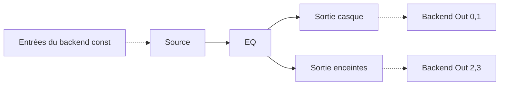

# Module 07 — Raccordement des canaux backend ↔ graphe

## Contrat final retenu

La couche backend transmet au callback un ensemble de pointeurs audio par canal, avec leur nombre et `frames`. Les entrées sont **strictement en lecture seule**, les sorties modifiables. Le plan **emprunte** leurs adresses à chaque callback ; aucune adresse ne peut être précompilée ni conservée par un Node après `process`. Ni `DAG::Connection` ni `ChannelID` n'encodent un canal matériel. Les canaux hardware sont indexés **par leur position dans la vue du backend**, à partir de zéro.

## Sources

Toute tâche dont le nœud **n'a aucune arête entrante** dans le DAG compilé reçoit le tableau **complet** des entrées backend dans son `ctx.inputs`, sans filtrage par `Config::layoutInput`. Le `process` peut lire 0, 1 ou N canaux ; oscillateur et synthétiseur peuvent tous les ignorer. Ses sorties logiques sont attribuées normalement dans le `BufferPool`. Le nombre de descripteurs d'entrées backend est préparé en amont en fonction des caractéristiques du flux ouvert ; le RT réaffecte seulement leurs pointeurs.

## Sorties désignées

Toute tâche dont le `NodeID` figure dans `DAG::outputsNodes` reçoit le tableau **complet** des sorties backend dans son `ctx.outputs`, sans filtrage par `Config::layoutOutput`. C'est son `process` qui choisit quelle entrée interne copier ou traiter vers chaque canal physique. **Plusieurs nœuds désignés autorisés**. Avant de commencer, mettre **toutes les sorties** à zéro ; politique `last writer wins` pour les échantillons/canaux réécrits ensuite. Aucune somme implicite. L'hôte est responsable des collisions involontaires ; il doit placer un `Mix` en amont lorsqu'il souhaite cumuler des signaux.

## Exemple casque et enceintes

`HP::process` écrit gauche/droite sur `ctx.outputs[0/1]`; `SP::process` sur `ctx.outputs[2/3]`. Chaque nœud voit pourtant tous les canaux ; les indices choisis sont un comportement de processeur ou de configuration applicative. Si `SP` écrit accidentellement sur `ctx.outputs[0]` après `HP`, son écriture gagne pour les samples recouverts. **LWW est par sample, pas par canal entier si un nœud n'écrit qu'une partie du bloc**.

## Cas concret Scarlett

Pour les prises indiquées « 2 » et « 6 » par le constructeur, un callback exposant au moins six canaux place leurs pointeurs respectivement à l'index `1` et `5` (dans cet exemple). Un `SourceNode` reçoit tout le tableau et peut produire : `output[0] = input[1]`, `output[1] = input[5]`. Ces indices ne sont pas des identités stables de périphérique à travers changement de configuration. Une éventuelle table `HeadphonesLeft -> endpoint+channel` appartient au niveau application / contrôle et doit être résolue lors de la reconfiguration.

## Contrats de validité

1. Vue externe en mémoire valide pour le **callback courant uniquement** ; nouveau binding à chaque bloc.
2. `ctx.inputs` des sources : `const float*` ; toutes les lectures bornées par `frames`.
3. `ctx.outputs` des sorties désignées : `float*` ; toutes les écritures bornées par `frames`.
4. Capacité de descripteurs >= nombre de canaux réels ; sinon plan invalidé pour le bloc et sortie silencieuse.
5. Tous les buffers de sortie backend sont effacés au début de chaque callback nominal.
6. Aucune copie systématique par `ExecutionPlan` à la frontière : seules les **adresses** des canaux sont raccordées. `process()` peut choisir de copier des samples.
7. Les sorties des nœuds sources restent des buffers internes, et les entrées des nœuds de sortie restent des buffers internes : pas de propagation magique de changement de pointeur à l'autre bout d'une arête.
8. Les nœuds de sortie n'écrivent jamais parallèlement en V1 ; l'ordre RT fixe le dernier écrivain.

## Pistes abandonnées

`InputBinding`/`OutputBinding` avec copies à la frontière, dérivation `HardwareInputNode`, encodage hardware via IDs réservés, exposition d'une `AudioInputView` séparée, patch des pointeurs de sortie des sources et patch de tous les consommateurs. Tous remplacés par l'usage direct des membres `inputs`/`outputs` du `ProcessContext` existant.

## Ambiguïtés conservées

La signature exacte des descripteurs externes dans `ProcessContext`, l'identité `ChannelID` à associer à un canal backend s'il faut remplir le champ `Channel::channel`, les sorties marquées ayant des consommateurs internes, et le cas d'une tâche à la fois source et sortie. Définir explicitement avant implémentation, sans rouvrir la décision « accès complet aux canaux ».
