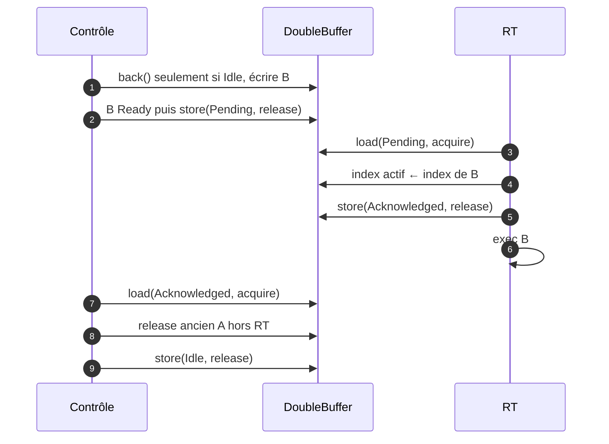
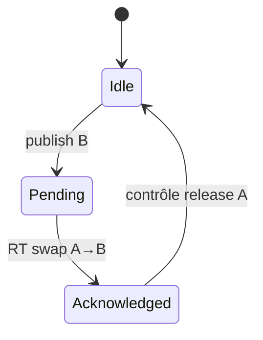

# Module 08 — `DoubleBuffer<ExecutionPlan>` et synchronisation

## But

Échanger un plan préparé non RT avec le plan exécuté par le callback **à une frontière de bloc**, sans attente RT, sans destruction RT et sans accès concurrent au contenu des plans. Exactement **deux** emplacements persistants A/B. Ne pas confondre avec les buffers circulaires PDC.

## Interface illustrative

```cpp
enum class ExchangeState : std::uint8_t {
    Idle,
    Pending,
    Acknowledged
};

template<class T>
class DoubleBuffer {
public:
    T& frontRt() noexcept;                // RT seulement
    T& backControl() noexcept;            // contrôle, sous Idle
    Result publish() noexcept;            // contrôle
    bool trySwapAtBlockBoundary() noexcept; // RT
    void releaseRetiredControl() noexcept; // contrôle après ACK

private:
    std::array<T, 2> plans_;
    std::atomic<ExchangeState> state_{ExchangeState::Idle};
    std::atomic<std::uint8_t> activeIndex_{0};
};
```

`front/back/swap/publish/release` figuraient dans la maquette. Les suffixes `Rt`/`Control` sont des suggestions de noms qui clarifient les threads. Le comportement exact est plus important que la forme de l'API.

## Séquence et ordres mémoire



Sur le bloc où R accepte B, A cesse d'être référencé avant publication de l'ACK : le contrôle peut nettoyer A lorsqu'il observe `Acknowledged`, même si B est en cours d'exécution. Le contrôle ne touche jamais B. Une seule requête Pending à la fois, pas de queue SPSC.

## Invariants

- `Ready` entièrement construit avant `Pending/release`.
- Après `Pending`, contrôle n'écrit plus dans B ; après ACK, contrôle ne détruit que A (retiré).
- `std::atomic` ne rend pas les buffers de plan eux-mêmes atomiques ; leur sûreté vient de la **propriété exclusive à chaque phase**.
- Le RT ne prend pas de lock et n'attend jamais la fin de compilation.
- Échec de préparation = aucune publication et plan actif conservé.
- La sélection de l'index et la transition d'état doivent former un protocole cohérent ; un `activeIndex_` atomique seul ne prouve pas qu'on peut modifier l'autre slot.
- En arrêt backend sans nouveau callback, prévoir une procédure de quiescence distincte pour vider Pending.

## États de plans et états d'échange

`PlanState {Free, Ready, Pending, Active, Retired}` = **statut conceptuel du contenu de chaque plan** ; `ExchangeState {Idle, Pending, Acknowledged}` = **drapeau atomique de synchronisation**. Ces deux ensembles ne sont pas interchangeables. Une implémentation peut déduire `PlanState` plutôt que le stocker dans chaque plan, tant que les transitions sont correctes.



## Destruction des Nodes

`ExecutionTask::node` emprunte un `Node*` au DAG. Le contrôle ne détruit ce Node que lorsque plus aucun plan A/B (`Ready`, `Pending`, `Active`, `Retired`) ne contient sa référence. L'ACK garantit la fin de l'utilisation de l'ancien plan, **pas** l'absence de toutes les autres références (B peut aussi référencer le Node). Les instances de plugins et leurs états ne deviennent pas automatiquement isolées par le simple fait de doubler les plans.

## Tests

Protocoles Idle→Pending→Acknowledged→Idle ; plusieurs swaps ; contrôle qui demande publication pendant Pending refusé ; RT qui ne reçoit aucun Pending conserve A ; échec B garde A ; retrait sans utilisation après destruction ; stress concurrent avec instrumentation ThreadSanitizer (selon faisabilité) ; arrêt du backend en Pending ; échange avec Node partagé A/B ; interleavings simulés des opérations atomiques.
