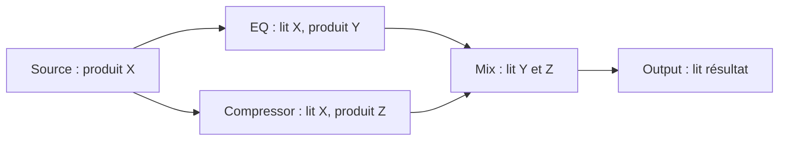
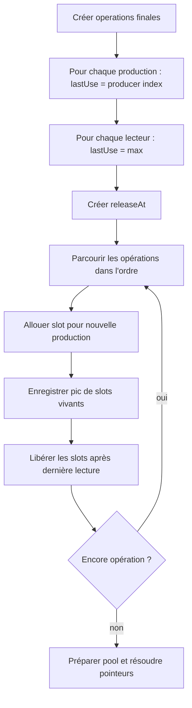

# Algorithme — `lastUse`, attribution des slots et recyclage statique

## Intuition

Deux signaux qui doivent être disponibles **en même temps** ne peuvent pas partager le même slot mémoire. Deux signaux dont les besoins ne se chevauchent jamais peuvent réutiliser le même emplacement de `float[maxFrames]` lors de tâches successives. Ce placement est décidé à la compilation, et non à chaque callback.

## Variables

| Symbole | Type recommandé | Rôle / durée |
|---|---|---|
| `order` | `vector<NodeID>` | Ordre topologique, temporaire contrôle |
| `operations` | `vector<CompiledOperation>` | Tâches finales, possédées par plan après compilation |
| `producedAt[signal]` | `size_t` | Index de production de chaque signal matérialisé, temporaire contrôle |
| `lastUse[signal]` | `size_t` | Index de dernier lecteur, temporaire contrôle |
| `releaseAt[i]` | `vector<SignalID>` | Signaux expirant après opération i, temporaire contrôle |
| `slotOf[signal]` | `BufferId` | Affectation de slot, utilisée pour créer pointeurs du plan |
| `freeSlots` | Collection d'`BufferId` | Simulation du placement hors RT |
| `liveSlots` | `size_t` | Nombre de slots actuellement vivants, temporaire contrôle |
| `peakSlots` | `size_t` | Maximum observé de `liveSlots`, dimensionne le pool |
| `maxFrames` | `uint32_t` | Capacité par slot, constante pendant plan |
| `reservedSlots` | `uint32_t` | Slots spécialisés, notamment silence |

`SignalID` est une notion **interne au compilateur** correspondant à une production de samples ; elle peut être un `ChannelID` de sortie ou une sortie intermédiaire de `DelayTask`. L'introduction du terme ne requiert pas un type public.

## Pseudocode

```text
Étape 1 : produire une liste finale d'opérations incl. PDC.
Étape 2 : pour chaque opération qui produit un signal S :
  producedAt[S] = operation.index
  lastUse[S] = producedAt[S]
Étape 3 : pour chaque entrée de chaque opération consommant S :
  lastUse[S] = max(lastUse[S], consumer.index)
Étape 4 : si une production doit rester disponible en fin de bloc
  prolonger son lastUse à l'index terminal approprié
Étape 5 : pour i de 0 à operations.size-1 :
  attribuer un slot à chaque production à i à partir des slots libres
  mettre à jour peakSlots
  APRES l'opération i, libérer les slots dont lastUse == i
  (à la même étape i, in-place seulement avec preuve de sûreté)
Étape 6 : réserver peakSlots + reservedSlots,
  initialiser tout stockage hors RT,
  lier les pointeurs vers les slots.
```

L'ordre *attribuer → exécuter → libérer* est conservateur. Un algorithme plus compact peut permettre `in-place` si un processeur lit avant d'écrire comme documenté et s'il est le dernier consommateur, mais cela doit être prouvé séparément.

## Exemple concret



`X` doit survivre à la lecture de A **et** de B. Il ne peut pas être recyclé juste après A. `Y` doit rester jusqu'à Mix, même si B se trouve entre A et Mix dans l'ordre. Une sortie `X` avec plusieurs lecteurs possède `lastUse[X]=max(index(A),index(B))`. À la fin du dernier lecteur, son slot devient libre pour une future production.

| Opération | Lit | Écrit | Slots encore nécessaires après |
|---|---|---|---|
| Source | — | X | X |
| EQ | X | Y | X, Y |
| Compressor | X | Z | Y, Z |
| Mix | Y,Z | W | W |
| Output | W | backend | Aucun (hors historiques persistants) |

Le tableau est conceptuel ; le placement précis des slots dépend de l'ordre du plan. Le slot de X peut être réemployé après Compressor, si aucune autre tâche n'en a besoin, mais **pas forcément pour Z dans cette même tâche** sans in-place explicite.

## Impact PDC

Une DelayTask lit un signal X, conserve un historique et produit une sortie Y retardée. `lastUse[X]` inclut la DelayTask, `lastUse[Y]` inclut tous ses consommateurs. `history` n'entre jamais dans la freelist de slots : elle est persistante jusqu'à la destruction du plan. Pour le fan-out `X→A` et `X→Delay→B`, X doit survivre jusqu'à la dernière utilisation des deux branches.

## Mémoire et vérifications

`peakSlots * maxFrames * sizeof(float)` est calculé via multiplication contrôlée. Ajouter `silenceSlotBytes`, alignements, `sum(delaySamples)*sizeof(float)` et métadonnées pour comparer à un budget total. La maquette historique détaille une heuristique de headroom de 30 % et un plafond 0,5 Go : **ce sont des valeurs proposées, non nécessaires à la correction**. Les durées de vie ne dépendent pas du nombre de callbacks, mais de l'ordre des opérations dans un callback ; en revanche l'historique PDC persiste entre callbacks.

## Flowchart



## Tests adversariaux

Diamant, fan-out 10 branches, chaines sans fan-out, plusieurs sources sans liaison, multiples sorties du même Node, source avec canal déclaré mais ignoré, signal consommé dans la même opération, parcours stable, contre-exemple où le pool réutilise un slot avant la lecture tardive, alignement PDC sur deux branches, `frames` variable, allocation 0/1 slot, in-place refusé, dépassement d'entier, taille de mémoire exact et headroom facultatif.
