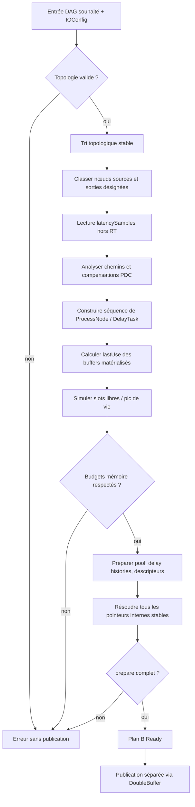

# Algorithme — Compilation `DAG → ExecutionPlan`

## Objectif et entrées/sorties

**Entrées (thread de contrôle)** : snapshot cohérent du DAG souhaité `nodes`, `connections`, `outputsNodes`; configuration backend effective (fréquence, `inputChannels`, `outputChannels`, `maxFrames`); budget mémoire et plafonds PDC. **Sortie :** plan B totalement préparé (`Ready`) ou erreur. Aucune mutation du plan A actif. Le compilateur ne doit pas être appelé depuis `Node::process()`.

## Pipeline recommandé

## Phases détaillées

### 1. Validation

Vérifier l'existence des Nodes, `Connection::from` `Out`, `to` `In|Aux`, absence de cycles, pas de double occupation d'une entrée et d'arêtes dupliquées. **Ne pas** exiger que le canal figure dans `Config`. Vérifier que les layouts de canaux effectivement traités ne contiennent pas de doublons incohérents. Vérifier que les IDs de sorties désignées existent. Pour l'exécution source, vérifier la capacité de descripteurs pour tous les canaux d'entrée backend ; pour les outputs désignés, toute la capacité sortie backend.

### 2. Tri topologique stable

Kahn ou DFS sans cycles, choisir un ordre stable (par exemple ordre d'insertion de nodes ou NodeID, documenté). L'ordre stable n'est pas seulement esthétique : en `last writer wins`, il détermine quel nœud de sortie écrase lequel. Construction `order[]` et `taskIndexOf[NodeID]` sur contrôle, coût `O(V+E)`.

### 3. Construction de la classification

Une **source** topologique n'a aucune connexion dirigée vers ses ports `In`/`Aux`. Un **nœud de sortie** figure dans `outputsNodes`. Les deux jeux d'IDs sont compilés en listes `sourceTaskIndices` et `outputTaskIndices`. Les sources voient les entrées backend entières ; les outputs désignés écrivent vers les sorties backend entières. Le conflit « sortie désignée qui produit aussi un buffer interne consommé » demeure à spécifier séparément.

### 4. PDC

`latencySamples()` est interrogée une fois par nœud. Le compilateur calcule l'accumulation de la latence par chemin, puis les retards de compensation à chaque jonction. Ajouter des opérations internes `DelayTask` **dans la séquence avant la consommation**. Les retards nécessitent des slots temporaires et des historiques persistants. L'analyse complète est décrite dans [PDC](PDC.md).

### 5. Buffers et durées de vie

**Très important :** calculer `lastUse` sur la **séquence finale après insertion PDC**, pas exclusivement sur le DAG d'origine. Une sortie logique non traitée par le `Config` n'oblige pas à créer un buffer si aucun `process` ne doit l'écrire et si aucun consommateur n'en a besoin : cette optimisation demande de conserver la sémantique des connexions ignorées, voir [questions ouvertes](../05-annexes/QUESTIONS_OUVERTES.md). Chaque sortie matérialisée reçoit un intervalle de vie de production à dernière lecture. Simuler la réutilisation et trouver `peakLiveSlots` ; ne pas réutiliser un slot trop tôt. Ajouter silence et éventuels slots réservés. `BufferPool::prepare` et delay histories allouent hors RT.

### 6. Relier les contextes

Pour chaque tâche interne, résoudre `inputs` et `auxiliary` vers les buffers des producteurs, ou vers silence pour une entrée traitée mais non connectée. Les `outputs` pointent vers les slots de leur production. Pour une tâche source, préparer des descripteurs de capacité `inputChannels`, remplaçables par les pointeurs du backend au callback. Pour une tâche sortie, préparer de même `outputChannels` en écriture. **Aucune liste de mapping `backend→ChannelID` n'est exigée** ; le développeur de `process` sélectionne directement l'indice voulu. Après la dernière allocation/relocalisation, résoudre les adresses internes puis **interdire tout déplacement** des structures pointées.

### 7. Validation finale et transaction

Vérifier : toutes les références internes pointent vers des slots existants et préparés, toutes les `DelayLine` initialisées, aucune tâche avec entrée attendue `nullptr`, mémoire dans le plafond, nombre max de frames enregistré, aucune adresse vers une mémoire déplacée. En cas d'erreur, détruire B hors RT, garder A actif, informer l'application que le DAG souhaité n'est pas encore engagé. La publication est un acte ultérieur, non une sous-routine de `compile()` exécutée implicitement.

## Exemple de séquence

DAG : `Source → A(64)` et `Source → B(256)` ; `A,B→Mix→Output`. Séquence candidate : `Process Source`, `Process A`, `Process B`, `Delay(A→Mix,192)`, `Process Mix`, `Process Output`. Les indices de tâche peuvent varier si l'ordre topologique le permet ; pour `last writer wins`, le compilateur choisit un ordre stable. Les `ProcessContext` des nœuds consomment les slots affectés lors de `compile` et les `DelayTask` intercalées.

## Complexité

Tri, calcul des latences et liveness: essentiellement `O(V+E)` après indexation appropriée ; attribution de slots dépend de la structure retenue (freelist, heap ou autre). Préparation mémoire `O(numberOfSlots*maxFrames + sumDelaySamples)` pour zéro-init. L'objectif est de payer ces coûts **hors RT**, pas de les éliminer à tout prix.
