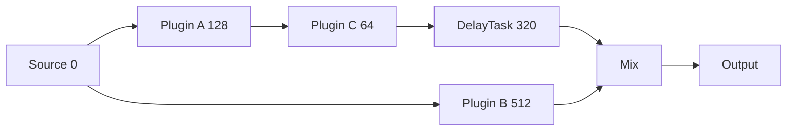

# Algorithme — Plugin Delay Compensation sur un DAG

## 1. Définition mathématique

Pour chaque `Node v`, `P(v)` est la latence algorithmique intrinsèque entière déclarée en samples (`uint32_t`, zéro par défaut). `L(v)` est le retard cumulé **après** avoir compensé les connexions entrantes, mesuré à la sortie du nœud. `pred(v)` sont les nœuds dont une connexion aboutit sur un `In` ou `Aux` audio utilisé. On calcule dans l'ordre topologique :

- Source sans prédécesseurs : `A(v) = 0`.
- Sinon : `A(v) = max(L(u))` pour `u∈pred(v)`.
- Sur chaque arête entrante `u→v` : `D(u,v) = A(v) - L(u)`.
- Latence cumulée à la sortie : `L(v)= A(v)+P(v)`.

Le calcul suppose que `P(v)` décrit un retard commun aux entrées/sorties audio du nœud. Ce n'est **pas** une formule générale pour tout plugin arbitraire à chemins internes distincts. Une connexion techniquement présente mais jamais utilisée par le process pose une question de définition de `pred(v)` ; V1 doit choisir soit l'alignement conservateur des connexions entrantes traitables, soit une analyse via `Config` des canaux effectivement traités. La seconde est plus fidèle à l'intention de `Config`, mais requiert une règle explicite sur les ports ignorés.

## 2. Exemple avec 3 plugins



Chemin `A→C = 128+64 =192`, chemin `B = 512`. À l'entrée de Mix, `A(Mix)=512`. Sur la branche C : `D(C,Mix) =512-192=320`. Sur la branche B : `0`. Le Mix reçoit deux flux synchronisés, avec une latence totale de 512 samples si Mix a `P=0`.

## 3. Pseudocode calcul hors RT

```text
for v in topologicalOrder:
    arrival = 0
    for edge in incomingAudioEdges(v):
        arrival = max(arrival, cumulativeLatency[edge.sourceNode])
    for edge in incomingAudioEdges(v):
        delay = arrival - cumulativeLatency[edge.sourceNode]
        if delay > 0:
            createDelayOperation(edge, delay)
    cumulativeLatency[v] = checked_add(arrival, declaredLatency[v])
```

Le modèle de temps est celui de samples sur une fréquence uniforme à l'intérieur du plan. Utiliser `uint64_t` pour `arrival`, `delay`, `cumulativeLatency` et vérifier limite mémoire et capacité avant de produire `DelayTask`. `createDelayOperation` crée une sortie logique intermédiaire dont le consommateur utilise le pointeur. Le DAG éditable n'est pas modifié.

## 4. PDC vers les sorties multiples

Si deux nœuds terminaux marqués écrivent dans des canaux matériels différents, l'analyse peut rechercher `G = max(arrivalAtTerminal(t))` ou des latences de chemins de sortie, puis ajouter un retard `G−arrival` avant le traitement terminal. Ne **pas** compter deux fois la latence propre au terminal : si sa `P(t)` est non nulle, la politique exacte de placement doit intégrer cette latence pour aligner **les samples effectivement écrits dans le backend**. Une règle simple proposée est de viser le maximum `L(t)` après traitement, puis d'insérer la différence avant les nœuds terminaux lorsque leur traitement est compatible avec un retard uniforme de ses entrées.

**Limite majeure du choix validé de routing :** les nœuds marqués ont un accès mutable à tous les buffers backend et choisissent librement où/quand écrire. Le compilateur ne peut pas prouver par quel canal matériel un signal sort, ni la relation temporelle d'une source interne générée directement dans `process`. La compensation globale est donc *par chemin de nœud*, pas une garantie de parfaite synchronisation de toute écriture arbitraire par canal hardware.

## 5. `DelayLine` sample-exacte

```cpp
void DelayLine::process(
    const float* source,
    float* dest,
    std::uint32_t frames
) noexcept {
    if (delaySamples_ == 0) {
        // No DelayTask should be emitted for zero delay.
        std::copy_n(source, frames, dest);
        return;
    }

    for (std::uint32_t i = 0; i < frames; ++i) {
        dest[i] = history_[cursor_];
        history_[cursor_] = source[i];
        ++cursor_;
        if (cursor_ == history_.size()) {
            cursor_ = 0;
        }
    }
}
```

Ce code est illustratif ; il suppose buffer valide, destination disjointe de source, et historique d'exactement `delaySamples_` échantillons, initialisé avec des zéros hors RT. `history_` et `cursor_` sont RT-owned pendant l'activité du plan. Pas de `std::vector::push_back`, pas de mémoire allouée dans la boucle. Même pour `delaySamples_ > frames` la logique fonctionne : l'historique traverse les blocs.

## 6. Exemple cross callback et preuve intuitive

`D=3`, historique initial `[0,0,0]`. Callback 1, entrée `[1,2,3,4]`, sortie `[0,0,0,1]`, historique contiendra une permutation circulaire des 3 derniers samples `[2,3,4]`. Callback 2, entrée `[5,6,7,8]`, sortie `[2,3,4,5]`. Le décalage temporel dépend uniquement du nombre de samples vus depuis l'initialisation, non du découpage en blocs.

## 7. États, publications et plugins partagés

La `DelayLine` est possédée par son `ExecutionPlan`, donc B repart d'historiques neufs lors d'une recompilation. Copier l'historique depuis A en plein `process` serait une data race. En V1, discontinuités possibles lors du swap. Pour un plugin dont le `Node` est partagé par A et B, il faut coordonner la nouvelle latence déclarée avec le moment où le plugin adopte sa nouvelle logique. **Un recalcul de PDC à lui seul ne garantit pas que le Node actif ne change pas de latence avant le swap** ; ne pas oublier cette condition à l'implémentation des adaptateurs.

## 8. Hors champ et tests

Hors champ V1 : latence d'entrée/sortie matérielle, multi-endpoint non synchronisé, MIDI/automation, migration d'historique et crossfade sans clic, traitement de phase non uniforme, queue de réverbération `TailInfo`. Tests : deux impulsions traversant branches de latences déclarées, délais 0,1,3,256,>maxFrames, callbacks variables, diamant, fan-out, sidechain audio, sortie multiple, `uint64_t` overflow, mémoire limitée, erreur compile sans publication.
