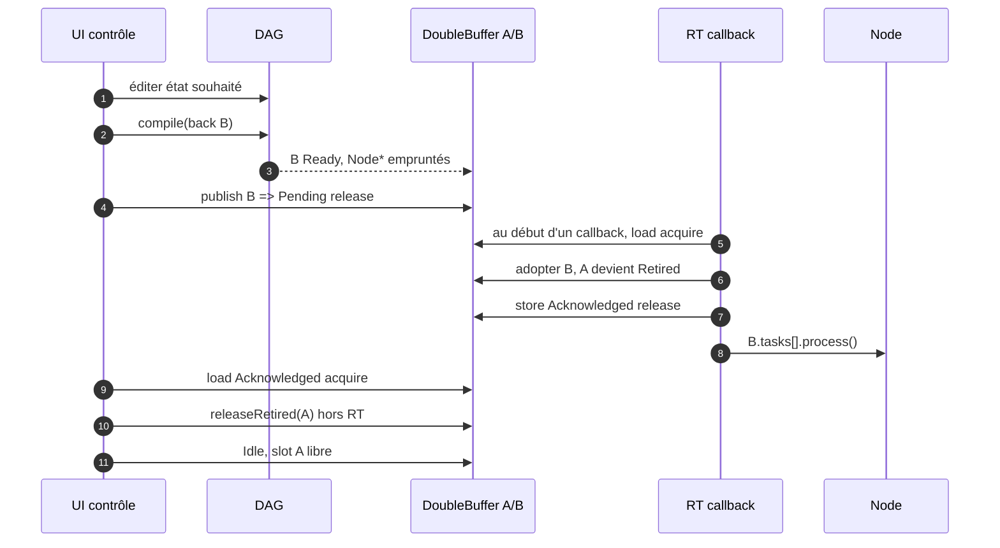
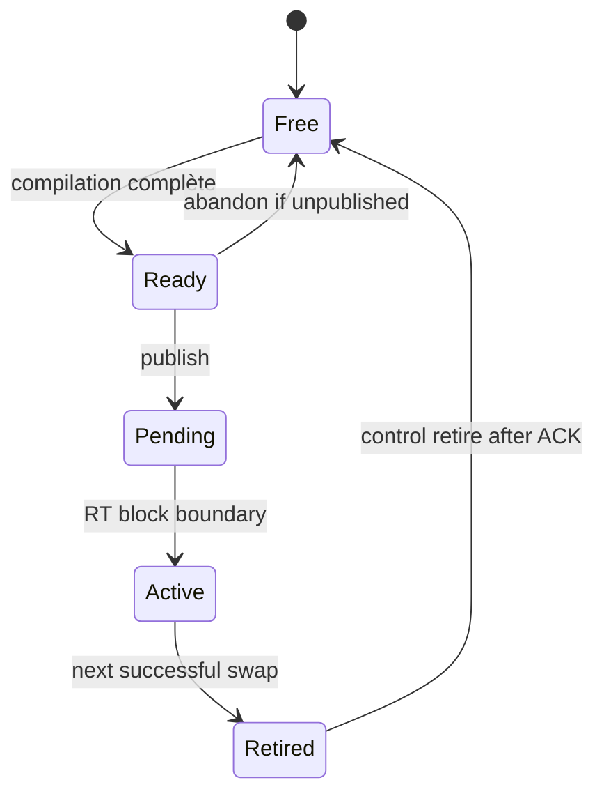
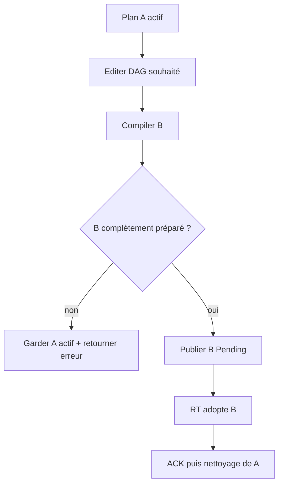
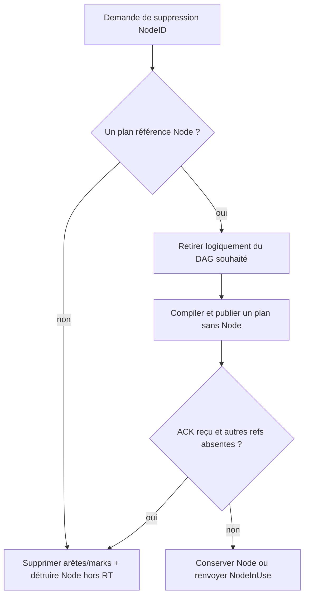

# Algorithme — Publication, swap, retrait et destruction

## Cycle nominal

Un `Pending` ne doit jamais déclencher une attente RT. Les deux plans gardent leur mémoire propre, y compris pools et delay lines. **Seuls les `Node*` peuvent être partagés**, sous réserve de la vie des objets et de la coordination des paramètres.

## Automate

Le drapeau d'échange externe vaut `Idle/Pending/Acknowledged`, tandis que les plans occupent leurs rôles `Free/Ready/Pending/Active/Retired` selon la génération. L'ordre atomique release/acquire synchronise la publication du contenu non atomique du plan B et la reconnaissance de son abandon par RT.

## Cas d'échec compilatoire

Ne pas écraser A pour « corriger » une ressource manquante ; le DAG souhaité peut rester plus récent que le plan réellement actif. Plusieurs éditions successives peuvent être fusionnées tant que B n'est pas publié.

## Cas suppression

Suppression physique d'un Node après preuve qu'il n'est référencé par **aucun** des deux plans. Un marquage de suppression souhaitée puis compilation d'une génération sans ce Node permet de conserver A sans crash jusqu'au swap. Après ACK, nettoyer A, vérifier B et toute autre référence, puis détruire le Node sur contrôle. Si cette stratégie n'est pas encore implémentée, `remove(id)` renvoie `NodeInUse` et laisse l'objet vivant.

## Plan actif avec PDC

Lors du swap A→B, l'historique des DelayTask B est neuf (par défaut tout zéro). Cela peut créer une rupture audible ; V1 n'exige pas de migration sans clic. L'état du plugin partagé doit être compatible avec la latence attendue par B au moment de l'activation, sans mutation de paramètres non atomiques par contrôle.

## Stop backend

Si le backend est arrêté, le callback peut ne plus venir reconnaître Pending. Une preuve externe de quiescence (backend confirmé hors callback) peut autoriser le contrôle à terminer un changement, vider Pending ou détruire tous les plans, mais **pas** en simulant un ACK pendant qu'un callback serait encore en cours. Procédure exacte à documenter dans l'intégration de la couche 0.
