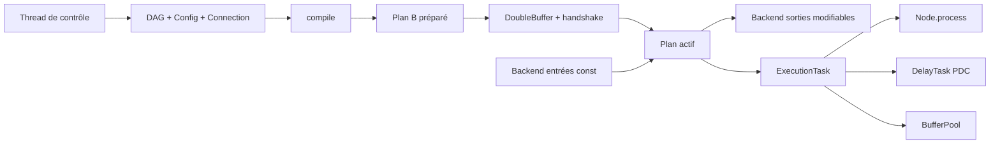

# MKA Audio DSP — dossier de conception et d’implémentation V1

**Édition :** 31 octobre 2026  
**Langue :** français  
**Cible :** C++26, `mka::audio::dsp`, moteur temps réel agnostique du backend.  
**Nature :** journal de recherche + contrats techniques + guide de réalisation. **Ce ne sont pas des déclarations qu'un dépôt a déjà été modifié ou que le code est implémenté.**

## Parcours de lecture

1. [Journal de décisions exhaustif](00-reference/JOURNAL_DE_DECISIONS.md) : progression chronologique, décisions maintenues et écartées, raisons, limites et questions ouvertes.
2. [Glossaire pédagogique](00-reference/GLOSSAIRE.md) : vocabulaire audio, C++, graphe et temps réel.
3. [Architecture globale](01-architecture/ARCHITECTURE.md) : dépendances, ownership, modèle de threads, frontières du backend et diagrammes de classes.
4. [Contrats transversaux](01-architecture/CONTRATS.md) : mémoire, synchronisation, const, états, durée de vie, erreurs et invariants.
5. [Guide d'implémentation](01-architecture/PLAN_IMPLEMENTATION.md) : étapes d'intégration et ordre des dépendances.
6. **Modules** : [Index des fiches](02-modules/README.md), puis une fiche par composant ou ensemble étroitement lié.
7. **Algorithmes** : [Compilation](03-algorithmes/COMPILATION.md), [allocation et recyclage](03-algorithmes/BUFFER_LIVENESS.md), [PDC](03-algorithmes/PDC.md), [publication et retrait](03-algorithmes/PUBLICATION.md).
8. **Validation** : [Plan de tests](04-validation/TESTS.md), [matrice de conformité](04-validation/MATRICE_EXIGENCES.md).
9. **Annexes** : [hypothèses, points à trancher](05-annexes/QUESTIONS_OUVERTES.md), [sources et concordance](05-annexes/SOURCES_ET_CONCORDANCE.md).

## Statuts des décisions

- **VALIDÉE** : choix explicite dans les échanges, conservé dans la V1.
- **ÉCARTÉE** : solution étudiée puis refusée ou remplacée.
- **REPORTÉE** : hors périmètre V1 ; conserver la trace.
- **PROPOSITION** : précision d'implémentation proposée ici pour rendre le contrat exécutable, **non** présentée comme une décision déjà validée.
- **À ARBITRER** : incohérence ou point non complètement défini par les discussions ; ne pas l'implémenter silencieusement comme une exigence historique.

**Important :** les extraits C++ sont des *interfaces de référence et pseudocodes typés*, non un kit de fichiers compilables. La V1 requiert la traduction des contrats dans l'API réellement disponible du projet. Les diagrammes Mermaid sont inclus dans les Markdown pour conserver leur éditabilité.

## Synthèse de la V1

`DAG` éditable par le thread de contrôle → `DAG::compile` → `ExecutionPlan` contenant `ExecutionTask`, `ProcessContext`, `BufferPool` et compensations PDC → publication via `DoubleBuffer<ExecutionPlan>` et handshake atomique → callback temps réel séquentiel. Sources = accès en lecture seule à toutes les entrées backend ; sorties désignées = accès en écriture à toutes les sorties backend ; routage déterminé par `Node::process`, sorties initialisées au silence et politique `last writer wins` dans l'ordre des tâches. Les historiques de retard sont persistants entre callbacks.

## Diagramme de bout en bout

